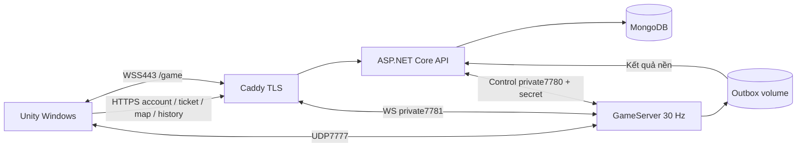

# LAST AWAY — Hồ sơ giới thiệu chính thức

**Concept · Gameplay · UI/UX · Mỹ thuật và âm thanh · Kiến trúc phần mềm và mạng · Dữ liệu · Vận hành**

Cập nhật **09/11/2026**, đối chiếu source tại commit `ff6a398e` và catalog/config hiện hành.

Tài liệu mô tả sản phẩm đang được tích hợp trong dự án, ưu tiên code và dữ liệu thực thi. Đây là hồ sơ giới thiệu chính thức, không phải bảng task hoặc bản đối chiếu với GDD. Cấu hình của từng release là căn cứ khi triển khai.

## Mục lục

1. [Giới thiệu và bản sắc](#1-giới-thiệu-và-bản-sắc)
2. [Các trụ cột thiết kế](#2-các-trụ-cột-thiết-kế)
3. [Luồng chơi và quản lý trận](#3-luồng-chơi-và-quản-lý-trận)
4. [Nhân vật, điều khiển và combat](#4-nhân-vật-điều-khiển-và-combat)
5. [Inventory, trang bị và tài nguyên](#5-inventory-trang-bị-và-tài-nguyên)
6. [Thế giới và hai map chính](#6-thế-giới-và-hai-map-chính)
7. [Safe Zone](#7-safe-zone)
8. [Rồng và trứng tiếp tế](#8-rồng-và-trứng-tiếp-tế)
9. [Bot server-authoritative](#9-bot-server-authoritative)
10. [UI/UX](#10-uiux)
11. [Art, camera, VFX và audio](#11-art-camera-vfx-và-audio)
12. [Kiến trúc tổng thể](#12-kiến-trúc-tổng-thể)
13. [Server authoritative và tick30 Hz](#13-server-authoritative-và-tick30-hz)
14. [UDP, WSS, Auto và packet](#14-udp-wss-auto-và-packet)
15. [Prediction, reconciliation và interpolation](#15-prediction-reconciliation-và-interpolation)
16. [Account, JWT, ticket và bảo mật](#16-account-jwt-ticket-và-bảo-mật)
17. [Đồng bộ map và nội dung](#17-đồng-bộ-map-và-nội-dung)
18. [Database, kết quả và lịch sử](#18-database-kết-quả-và-lịch-sử)
19. [Các môi trường chơi](#19-các-môi-trường-chơi)
20. [Hạ tầng, deploy và vận hành](#20-hạ-tầng-deploy-và-vận-hành)
21. [Phân tích lựa chọn kỹ thuật](#21-phân-tích-lựa-chọn-kỹ-thuật)
22. [Chất lượng và giới hạn](#22-chất-lượng-và-giới-hạn)
23. [Cấu trúc source và tham chiếu](#23-cấu-trúc-source-và-tham-chiếu)
24. [Thuật ngữ](#24-thuật-ngữ)

---

## 1. Giới thiệu và bản sắc

**LAST AWAY là game sinh tồn đối kháng 2D góc nhìn từ trên xuống, chơi theo trận, mang phong cách fantasy pixel art.** Người chơi khám phá rừng, tháp đá, di tích và thị trấn; tìm vũ khí, quản lý tài nguyên, tận dụng địa hình và giao chiến để trở thành người sống sót cuối cùng.

Điểm hấp dẫn nằm ở các quyết định liên tục: tìm thêm đồ hay chạy bo; hồi máu hay tiếp tục bắn; tranh trứng rồng hay giữ vị trí; đuổi theo đối thủ hay bảo toàn số đạn còn lại. Cận chiến, súng, vật ném và vật phẩm fantasy cùng tồn tại, tạo nhiều cách tiếp cận một trận.

Nhân vật chibi và pixel art giúp nhận diện nhanh. Giao diện đá/viền vàng, kiến trúc cổ, rừng, rồng và trứng tạo một ngôn ngữ hình ảnh thống nhất. Rồng không chỉ là trang trí: nó công bố một mục tiêu tài nguyên có thể làm thay đổi hướng di chuyển và giao tranh.

| Thuộc tính                             | Đặc điểm                                             |
| ---------------------------------------- | -------------------------------------------------------- |
| Tên sản phẩm                          | LASTAWAY                                                 |
| Tên kỹ thuật kế thừa                | Jungle Maze/JungleMaze trong namespace và công cụ     |
| Thể loại                               | Sinh tồn FFA/battle royale 2D theo trận                |
| Góc nhìn                               | Top-down, camera theo nhân vật                         |
| Nền tảng phát hành client hiện tại | Windows                                                  |
| Công nghệ                              | Unity6/C#/URP, backend .NET8                             |
| Một người                             | Luyện tập offline                                      |
| Chơi mạng                              | Local Docker, LAN, VPN Tailscale, Internet tự host, AWS |
| Quy mô phòng                           | Tối đa10 nhân vật, tính cả bot                     |
| Mục tiêu thời lượng                 | Khoảng 7 phút                                          |

Tên kỹ thuật JungleMaze không tạo một hệ tài khoản hoặc trò chơi riêng với LAST AWAY.

## 2. Các trụ cột thiết kế

### 2.1. Sống sót là quyết định tổng hợp

Khả năng gây damage quan trọng nhưng không đủ. Đạn, HP, giáp, đường rút, thời gian hồi phục và vị trí so với bo cùng quyết định người chơi có tiếp tục trận hay không. Bo giảm không gian khiến né giao tranh vô thời hạn không phải chiến thuật bền vững.

### 2.2. Tài nguyên tạo xung đột

Rương, chum, đồ trên đất, death-drop và trứng tiếp tế là nguồn tranh chấp chung. Người chơi phải thực sự tới, phá hoặc tương tác. Hai người cùng nhặt một món không được nhận hai bản chỉ vì packet tới gần nhau.

### 2.3. Địa hình tham gia gameplay

Công trình, tường, cover, bụi và vật thể thế giới tạo đường đi và tình huống chiến đấu. Geometry có trách nhiệm chặn đường/hit; sprite và animation giúp đọc thế giới, không tự thay luật collision.

### 2.4. Một nguồn quyết định khi chơi mạng

Client gửi mong muốn hành động; server quyết định vị trí, inventory, HP và kết quả. Prediction giúp phản hồi nhanh, không trao quyền tự xác nhận chiến thắng. Bot cũng dùng luật chung thay vì có quyền sửa state tùy ý.

### 2.5. Dễ tổ chức nhóm nhỏ

Offline phục vụ luyện tập; Local phục vụ phát triển; selfhost/VPN và AWS phục vụ chơi cùng bạn bè. Bot bổ sung số lượng để bắt đầu mà không phải đợi sáu người thật. Quy mô này được thiết kế như các phòng nhỏ, không được giới thiệu thành MMO hoặc thế giới liên tục.

## 3. Luồng chơi và quản lý trận

### 3.1. Luồng chính

**Chọn máy chủ → đăng ký/đăng nhập → tạo/vào phòng → chọn skin/map, bổ sung bot → xác minh map → chủ phòng Bắt đầu → countdown → Loading → trận → spectator/kết quả → lịch sử/chơi lại/menu.**

Backend được chọn xác định account và dữ liệu sử dụng. Account Local không tự trở thành account AWS; chọn VPN khác đồng nghĩa tới một server khác.

Trong trận, vòng lặp là **khám phá → loot → nâng trang bị → giao chiến hoặc tránh né → chạy bo → thích ứng**. Đầu trận ưu tiên tài nguyên; giữa trận cân bằng giao tranh với vị trí, trứng rồng tạo điểm nóng; cuối trận không gian và đường rút thu hẹp.

### 3.2. Cấu hình phòng và trận

| Hạng mục                | Chính sách hiện hành                                         |
| ------------------------- | ---------------------------------------------------------------- |
| Nhân vật/phòng         | Tối đa10, gồm người và bot                                 |
| Phòng/server             | Tối đa5, gồm phòng mặc định                               |
| Slot/server               | Tối đa50, gồm active/pending/grace/bot                        |
| Phòng bổ sung/account   | Tối đa2                                                        |
| Bắt đầu profile chính | Tối thiểu6 participant                                         |
| Countdown                 | 5 giây                                                          |
| Loading                   | Tối đa30 giây                                                 |
| Disconnect grace          | Tối đa15 giây từ khi phát hiện disconnect                  |
| Ending                    | 10 giây hoặc mọi người còn kết nối xác nhận chơi lại |
| Phòng tạo thêm trống  | Thu hồi sau10 phút liên tục                                  |
| RoomCode tạo thêm       | 6 ký tự chữ hoa/số, ngẫu nhiên phía server                |

Slot pending và grace tính vào hạn mức để không nhận vượt sức chứa khi nhiều kết nối đồng thời. **Trần50 slot không phải cam kết50 người thật qua Internet luôn mượt.**

### 3.3. Phòng mặc định và quyền

Phòng mặc định dựng từ `ROOM_CODE`/sức chứa cấu hình, được tạo lại sau restart. Phòng bổ sung lưu RAM, không phải document lâu dài trong Mongo.

Account sở hữu phòng và trưởng phòng trong phiên là hai vai trò khác nhau. Account tạo phòng có quyền API quản lý/xóa khi trống. Trưởng phòng đang kết nối chọn map, thêm/xóa bot và bắt đầu. Phòng tạo thêm đợi chủ account vào nhận vai trò ban đầu; phòng mặc định chọn người vào đầu. Trưởng phòng rời phòng chờ thì quyền chuyển sang người đang kết nối vào sớm nhất. Bot không làm trưởng phòng.

### 3.4. Vòng đời

`Waiting → Lobby → Loading → InGame → Ending → Cleanup → Waiting`.

Waiting cho phép cấu hình. Chủ phòng bấm Bắt đầu sau khi đủ người và các client xác minh map; một người+năm bot đủ ngưỡng chính. Vào/rời trong countdown hủy lượt bắt đầu. Loading chốt roster, chờ xác nhận có timeout. Loading/InGame/Ending không nhận người mới chen vào trận; resume hợp lệ là luồng riêng.

Damage của toàn tick được xử lý trước khi xét thắng. Còn một người sống thì thắng; không còn ai thì hòa và không trao win. Cùng tick bị loại đồng hạng. Hạng theo diễn biến sống sót, không tự tạo công thức điểm tổng.

Disconnect giữ avatar/slot trong grace; avatar đứng yên nhưng vẫn chịu damage. Hết grace hoặc chủ động rời bị loại. Cleanup dọn entity/input/bo/callback cũ, giữ phòng và các kết nối hợp lệ. Trận mới có MatchId mới.

### 3.5. Offline

**Luyện tập offline** vào Game không cần account/API/Docker. Người chơi vẫn thử world, loot, combat, HP, bo và kết quả/chơi lại. Solo không thắng ngay chỉ vì có một người; có thể luyện tới khi bị loại. Không lưu thành tích online. Bot quản lý theo phòng thuộc luồng mạng, không mặc định có trong luyện tập offline.

## 4. Nhân vật, điều khiển và combat

### 4.1. Nhân vật

Thông số nền: **100 HP, tốc độ4 cell/s, bán kính collision0,4 cell**. Di chuyển8 hướng, chuẩn hóa đường chéo. Chuột xác định hướng ngắm. Skin phục vụ nhận diện hình ảnh, không phải quyền thay tốc độ hoặc damage.

| Thao tác                       | Điều khiển                       |
| ------------------------------- | ----------------------------------- |
| Di chuyển                      | WASD/mũi tên                      |
| Ngắm, đánh/bắn              | Chuột, chuột trái                |
| Nhặt/tương tác hợp lệ     | F, có chỉ dẫn khi vào tầm      |
| Reload                          | R                                   |
| Chọn ô vũ khí               | 1–4                                |
| Chọn ô vật phẩm             | 5–8; dùng theo luồng item/HUD    |
| Bỏ vũ khí đang cầm         | Q                                   |
| Menu/đóng lớp UI trên cùng | ESC                                 |
| Chẩn đoán mạng              | F3                                  |
| Chuyển người xem             | A/D hoặc trái/phải khi spectate  |
| Xem người hạ mình           | E khi spectate, nếu có mục tiêu |
| Bỏ qua killcam                 | Space trong killcam                 |

**Backspace đã bỏ khỏi drop** để bộ gõ tiếng Việt sửa dấu không vô tình bỏ vũ khí. Phím spectator/killcam chỉ có ý nghĩa theo trạng thái; không suy thành kỹ năng của nhân vật đang sống.

### 4.2. Vũ khí

| Nhóm       | Định danh hiện có trong dữ liệu            | Đặc trưng                                               |
| ----------- | ------------------------------------------------ | ---------------------------------------------------------- |
| Cận chiến | HAND, TREE_BRANCH, KNIFE, BONE, AXE, MACE        | Damage, cooldown, range và góc quét khác nhau          |
| Tầm xa     | RUBBER_GUN, SCEPTER, CROSSBOW, SHOTGUN           | Đạn/projectile, tầm, nhịp, pellet và reload           |
| Súng       | PISTOL, ASSAULT_RIFLE, SNIPER_RIFLE              | Bán tự động/tự động, băng đạn và đạn dự trữ |
| Vật ném   | BANANA, SMOKE, METEORITE_FRAGMENT, CRYSTAL, SEED | Thời gian kích hoạt và tác động vùng               |
| Đặc biệt | ROPE, BELL, SAHUR_BAT                            | Hành vi riêng qua service combat/effect                  |

Ví dụ: Pistol băng12 viên; Assault Rifle băng24, nhịp cơ sở6 phát/s; Sniper Rifle băng5, damage cơ sở65, reload3 s. Đây là số trước phòng thủ/điều kiện hit, không có nghĩa mỗi phát luôn trừ đúng lượng HP đó.

Combat kiểm cooldown, ammo, range/hit và điều kiện trạng thái. Client không gửi HP/rank tự khai làm kết quả. Vật phá được đi qua destructible/loot service; packet lặp không được nhân loot hoặc hành động.

### 4.3. Phản hồi

HUD hiển thị vũ khí và đạn; vòng trắng fill biểu thị reload, không cần nhãn chữ giữa màn hình. HP thực giảm gây nháy đỏ khoảng 0,16 s và số HP mất; spawn, hồi máu hoặc snapshot lặp không gây damage giả. VFX phản ánh kết quả, không phải nơi quyết định trừ HP.

## 5. Inventory, trang bị và tài nguyên

Inventory giữ slot, stack, món đang chọn, ammo và trang bị. Nhặt/đổi/dùng/bỏ đều có điều kiện; online model server là nguồn chuẩn. Hình vũ khí trên tay là view riêng với quyền sở hữu món trong inventory.

Mũ/giáp có cấp wooden, spike/armor và magic, tỷ lệ giảm damage và durability. Nâng đồ thay đổi khả năng sống sót; không làm người chơi miễn nhiễm bo.

| Item             | Chức năng/thông số cấu hình                   |
| ---------------- | --------------------------------------------------- |
| GOD_LEAF         | Hồi10 HP, dùng0,5 s                               |
| SPIRIT_TEAR      | Hồi15 HP, dùng0,8 s                               |
| MERMAID_TAIL     | Hồi25 HP, dùng1,2 s                               |
| PHOENIX_FEATHERS | Hồi45 HP, dùng2 s                                 |
| UNICORN_BLOOD    | Hồi tới100 HP trong giới hạn health, dùng3,5 s |
| ADRENALINE       | Hiệu ứng tốc độ8 s                             |
| ELIXIR           | Hồi phục/cleanse theo service                     |
| MAGIC            | Invisible, thời lượng cấu hình5 s              |
| ELIXIR_OF_LIFE   | LifePassive theo inventory/health                   |
| COMPASS          | Hiệu ứng la bàn theo cấu hình                  |
| AMMO             | Tài nguyên đạn                                  |

Thời gian dùng tạo đánh đổi: hồi nhiều thường cần an toàn lâu hơn. Hủy dùng và trạng thái kiểm soát phải theo luật service; UI bấm được không có nghĩa đã dùng thành công. Không suy danh sách effect thành bộ kỹ năng mới chưa được ghép.

Nguồn loot, trọng số, rarity và số lượng do catalog điều khiển. Seed/runtime quyết định lượt sinh. Death-drop dùng hệ chung; đồ bị nhặt hoặc vật đã phá không được tạo lại khi reconnect.

## 6. Thế giới và hai map chính

Catalog generation5 phát hành:

| Map        | ID       | Version | Geometry      | Spawn | Bản sắc                                       |
| ---------- | -------- | ------- | ------------- | ----- | ----------------------------------------------- |
| Tháp cổ  | thap-co  | 1.2.0   | 150×150 cell | 10    | Tháp đá, di tích và rừng                  |
| Thị trấn | thi-tran | 1.2.0   | 150×150 cell | 10    | Nhà gạch, đường phố, lối giao tranh hẹp |

Mặc định **Tháp cổ**. File cũ ngoài catalog không tự thành lựa chọn của người chơi.

Tháp cổ có1.354 obstacle/223 world object; Thị trấn có1.279 obstacle/181 world object trong payload hiện hành. Đây là phần tử dữ liệu, không tương đương số công trình nhìn thấy hoặc draw call. Mỗi map có10 spawn cùng bố trí rương/chum/bụi/portal/Supply riêng. Catalog này có4 object Portal/map; không lấy số từ template demo áp cho mọi map.

Hệ world có xử lý cửa, swamp, lava và poison theo cấu hình; xuất hiện ở đâu do payload map quyết định. Geometry/collider chân do dữ liệu authoritative; sprite cao không có nghĩa collider cao bằng sprite. Sorting theo chiều sâu giúp đọc đúng trước/sau công trình.

Level Editor phục vụ đặt đối tượng và xuất JSON/preview. Chọn map đổi geometry, spawn và world state, không chỉ đổi ảnh nền. Loot/HP/cửa bị phá trong trận là state riêng của phòng, không sửa payload map dùng chung.

## 7. Safe Zone

Lịch nền trong `zone_schedule.json` dành map50×50, tâm(25,25), r25. **Runtime scale theo map thực**: hai map150×150 dùng hệ số3, tâm đầu(75,75), r75. Giữ thời gian/damage, scale bán kính/tốc độ co.

| Đợt | Thời gian từ InGame | Bán kính nền | Bán kính map chính |
| ----- | --------------------- | --------------- | --------------------- |
| 1     | 90–97 s              | 25→18          | 75→54                |
| 2     | 182–188 s            | 18→12          | 54→36                |
| 3     | 268–273 s            | 12→7           | 36→21                |
| 4     | 343–347 s            | 7→3            | 21→9                 |
| 5     | 387–390 s            | 3→0            | 9→0                  |

Vòng tròn nội tiếp không bảo vệ các góc của map vuông. Tâm chọn theo seed, bo sau nằm trong bo trước và có vùng tiếp cận hợp lệ. Server phát tâm hiện tại/kế tiếp và tick; client không tự random.

Ngoài bo **5 HP/s**, bỏ qua giáp. R0 gây damage mọi vị trí, kể cả tâm, tới khi đủ điều kiện kết thúc.420 s là mục tiêu nhịp trận, không lệnh kết thúc cứng.

Minimap/bản đồ lớn có **viền trắng bo kế tiếp ngay khi có dữ liệu**, không chỉ10 s cảnh báo. Khi co giữ ở đích; co xong chuyển mục tiêu tiếp. R0 hiển thị dấu tâm phù hợp, hết lịch không dựng vòng giả. Lớp phủ nguy hiểm cho biết vùng hiện tại, vòng trắng giúp lập kế hoạch.

## 8. Rồng và trứng tiếp tế

| Lượt | Bắt đầu bay | Đáp |
| ------ | -------------- | ----- |
| 1      | 1:50           | 2:00  |
| 2      | 3:50           | 4:00  |
| 3      | 5:20           | 5:30  |

Mỗi DropId trong MatchId có state **Scheduled→Flying→Falling→Landed→Broken**, hoặc hủy khi không có vị trí hợp lệ. Điểm đáp theo seed, geometry và bo dự báo tại lúc đáp; cách mép bo3 cell, footprint không chồng vật/hazard/portal/trứng, có đường tới. Tìm ứng viên có trần, retry mỗi giây tối đa 5 lần, không ép đặt xuyên vật thể.

Trứng **2×2 cell,150 HP**, chưa nhận hit/chặn đường lúc trên không. Sau đáp trở thành Supply phá được. Đánh/bắn để mở, **F chỉ nhặt loot sau khi vỡ**. Mỗi trứng6–8 stack không lặp loại, đảm bảo **MACE và COMPASS**; phần còn lại chọn theo trọng số Supply.

Runtime dành trước sức chứa3 trứng/24 stack. Nếu chưa thể sinh đủ, không phá thành công rồi mất đồ. Hit đồng thời chỉ phá/sinh loot một lần.

Client dựng rồng, bóng, rơi/đáp/vỡ, HP và marker từ đường bay/tick authoritative. Resume lấy baseline hiện tại, không sinh lại loot hoặc tiếng gầm cũ. Sự kiện công khai tạo điểm tranh tài nguyên cho cả người và bot.

## 9. Bot server-authoritative

Bot FFA đánh người và bot, có thể thắng; không có socket/account/JWT giả. Chủ phòng **+Bot/Xóa bot/Điền đủ6** khi Waiting. Bot chiếm slot thật, không tự bị thay bởi người mới; bot không làm trưởng phòng.

| State               | Vai trò                                                |
| ------------------- | ------------------------------------------------------- |
| Idle/Roam           | Quan sát, tìm đường và mục tiêu                 |
| Loot/BreakContainer | Lấy đồ hoặc phá vật bằng combat thật            |
| Chase/Combat        | Tiếp cận và chiến đấu trong điều kiện hợp lệ |
| Search              | Tìm quanh vị trí thấy cuối                         |
| Retreat/Heal        | Rút lui và dùng thuốc                               |
| EscapeZone          | Ưu tiên thoát bo/nguy hiểm                          |
| Dead                | Dừng intent, loại/death-drop                          |

Mỗi bot có state, mục tiêu, memory, path, cooldown và seed. Think/perception5 Hz lệch lịch, movement/combat30 Hz. Thông số Normal: detect12 cell, reaction350 ms, memory3 s, aim error±6°, heal≤40%HP, retreat≤25%HP. Bụi/Invisible/che khuất được xử lý trong perception; mất dấu không được bám vị trí thật vô hạn. Marker thính là thông tin công khai hợp lệ.

A* lưới0,5 cell, kiểm bán kính và cắt góc. MapHash chia sẻ nền navigation; cửa/vật phá riêng từng phòng. Giới hạn500 node/request,1.500 node/tick toàn server và budget thời gian mềm; chia việc qua tick. Kẹt thì tính lại/bỏ mục tiêu, không teleport hoặc tăng tốc.

Bot giữ số lượng qua lượt mới nhưng reset HP/inventory/FSM. Không còn người thật kết nối hoặc grace thì dừng `NoHumans`, không trao win để bot tự chơi mãi. Người chết còn spectate vẫn là người xem.

Result có **HumanOnly/WithBots** và **IsBot**. Người thật vẫn có lịch sử trận bot nhưng không cộng như PvP thuần người. Metadata này độc lập việc UI đã bỏ chữ “Có Bot” trên bảng hạng.

## 10. UI/UX

### 10.1. Login, menu và skin

Login/register và menu dùng splash fantasy pixel art cùng concept rừng/tháp/rồng/trứng. Menu có ảnh riêng chừa không gian cho logo **LAST AWAY**, preview skin và các nút. Chữ, form và button là UI thật; không vẽ cứng vào background. Nền cần crop giữ tỉ lệ, lớp tối hỗ trợ đọc mà không chặn click.

Menu tập trung vào Vào phòng, Tạo phòng, Lịch sử, Bảng xếp hạng, Cài đặt, Thoát và Luyện tập offline. Account hiện tại và đăng xuất giúp người chơi biết mình đang dùng danh tính nào. Skin là lựa chọn ngoại hình, không một hệ nâng cấp sức mạnh.

### 10.2. Máy chủ

Một bảng Máy chủ tập trung lựa chọn môi trường và cấu hình, không tạo các menu kết nối song song. Mở game thường mặc định **Online·AWS**; Local/LAN/VPN/selfhost là lựa chọn chủ động. Profile test hoặc dòng lệnh có thể chọn khác khi phát triển.

Tailscale gồm phần **Chơi cùng bạn** dán địa chỉ/kiểm tra/kết nối và phần **Tự làm host** chọn Backend/thiết lập/bật/dừng/status/copy. Tác vụ host chạy bất đồng bộ để không treo UI khi Docker hoặc mạng chậm. API thông không được báo thành gameplay đã thông: cần join và pong.

### 10.3. Phòng chờ

Phòng chờ giữ mã phòng/copy, danh sách người và bot, vai trò trưởng phòng, lựa chọn skin. Thẻ map hiển thị preview, tên, mô tả, version và đang chọn. Có số client đã tải, lý do chưa bắt đầu và thử tải lại khi lỗi.

Người không có quyền thấy trạng thái chờ chủ phòng; sửa nút client không thể vượt kiểm quyền server. Đổi map reset readiness. Tải lỗi không tự lấy map khác rồi báo sẵn sàng. Đóng/chuyển phòng bỏ callback cũ để tác vụ chậm không mở sai màn hình.

### 10.4. HUD và thao tác

HUD cung cấp HP, giáp/mũ, vũ khí, item, số đạn, minimap/bo và người còn sống. Chỉ dẫn F, vòng reload, damage number và hit flash cho phản hồi ngắn gần hành động, tránh buộc người chơi đọc bảng kỹ thuật.

F3 chứa số đo phục vụ phát triển, không phải HUD bắt buộc. ESC đóng lớp trên cùng/menu theo ngữ cảnh; **không pause trận online** và không ngăn nhân vật nhận damage. Popup có chặn action theo input gate, không được hiểu là server ngừng chạy.

### 10.5. Bị loại, spectator, killcam, kết quả

Sau khi bị loại, client chuyển luồng xem thay vì tiếp tục điều khiển avatar như còn sống. Spectator đổi mục tiêu, có thể tới người hạ mình nếu dữ liệu phù hợp. Camera mục tiêu spectator không bị ép về nhân vật đã chết.

Killcam lấy replay buffer server khoảng 5 giây theo quyền phiên, không phải video quay màn hình. Nạn nhân chỉ nhận phần cần thiết liên quan mình/killer, giới hạn request và chunk; không có dữ liệu hoặc cửa sổ quá ngắn thì báo không khả dụng. Không công khai toàn bộ replay mọi người để làm lộ thông tin.

Kết quả lấy authoritative rank, kills/thời gian sống/lý do kết thúc. Người chơi về phòng hoặc menu, xem lịch sử qua API. Bảng hạng trận không đồng nghĩa một hệ ranked toàn mùa/matchmaking rating nếu chưa có luật đó.

## 11. Art, camera, VFX và audio

### 11.1. Trình bày hình ảnh

Pixel fantasy dùng nhân vật chibi, outline rõ, môi trường đá/gạch/rừng và icon vật phẩm. UI đá/vàng thống nhất với background, logo và thế giới. Sorting theo chiều sâu giúp đọc trước/sau công trình; URP đảm nhiệm pipeline hình ảnh của client.

Camera bàn giao mặc định **Follow Player**; spectator giữ mục tiêu của trạng thái xem. Chế độ camera debug nhìn toàn map không phải trải nghiệm mặc định.

VFX tái sử dụng body anchor/director/pool: hit flash, số damage, attack/projectile và hiệu ứng world/rồng/trứng. Màu cần được trả đúng sau flash/death/despawn, không mất tint trạng thái hoặc tác động transform vũ khí. Hiển thị trên nhân vật phải tôn trọng visibility, không làm lộ người bị ẩn.

Art imported là nguồn tái sử dụng, không tự biến code Socket.IO cũ thành client mạng chính. Nguồn art/audio có manifest và tình trạng giấy phép riêng; tích hợp kỹ thuật không tự chứng minh quyền thương mại của mọi asset.

### 11.2. SFX và nhạc

Hệ đăng ký **29 gameplay SFX ID**, chưa tính số clip biến thể hoặc UI. Nhóm âm gồm bước chân/cỏ/swamp/bụi, melee swing/hit, shot/crossbow, throw/reload/empty click, fuse/explosion/trap, hit marker/hurt/armor, chết, nhặt/mặc/dùng/hủy, cảnh báo bo, rồng và trứng.

`game_menu_looping` phục vụ nhóm màn menu/phòng chờ/kết quả theo MusicPlan. **Trong InGame không phát nhạc nền gameplay**, để người chơi nghe combat và cảnh báo. Thắng dùng cue Victory/`victory.wav`; thua/kết thúc dùng cue khác, không phát âm thắng chung cho mọi người.

DragonRoar toàn cục một lần khi bắt đầu lượt bay. EggLand/EggBreak theo vị trí và suy giảm khoảng cách. Resume/snapshot lặp không phát lại âm lịch sử.

### 11.3. Kiến trúc audio

Audio event source nhận sự kiện gameplay thật. Router/scheduler/deduper/voice allocator tách việc gì xảy ra khỏi AudioSource phát clip. Pool giới hạn voice và ưu tiên, tránh nhiều âm nhỏ lấn cảnh báo quan trọng. Mixer có Master/SFX/Music/Alert, Alert theo thiết lập SFX.

Đạn dự đoán và xác nhận online không được tạo hai tiếng bắn cho cùng hành động. Tiếng hit không được dùng để tự chứng minh hit đã được server chấp nhận. Kiểm routing/clip trong test và đánh giá nghe bằng tai là hai bước khác nhau.

## 12. Kiến trúc tổng thể

### 12.1. Ba khối chính

1. **Unity Windows client:** input, flow/UI/HUD, render/camera/audio, prediction/interpolation, giao tiếp HTTP và gameplay.
2. **GameServer .NET8:** session/phòng/trận, movement/collision, combat, inventory/world, bot/bo/rồng và kết quả authoritative.
3. **ASP.NET Core API + MongoDB:** account/JWT/ticket, quản lý phòng, nội dung map, lịch sử và ghi kết quả.

REST là đường tài khoản/nội dung; UDP/WSS là đường realtime. Hai transport tới **cùng SessionHub/RoomManager/runtime**, không có hai phiên bản trận chạy song song.

### 12.2. Client theo ranh giới Clean Architecture

| Lớp                  | Trách nhiệm                                                   |
| --------------------- | --------------------------------------------------------------- |
| Core                  | DI, EventBus, StateMachine, pool, công cụ nền                |
| Domain                | Model/giá trị/luật C# thuần                                 |
| Application           | Use case, session/flow, prediction, port/interface              |
| Infrastructure        | Adapter mạng/HTTP/file/config/hệ điều hành                 |
| Presentation          | View/presenter, MonoBehaviour, input/HUD/VFX/audio output       |
| Bootstrap             | Composition root tạo/nối dependency và quản lý vòng đời |
| Shared Protocol/World | Schema/serializer và phần luật/dữ liệu dùng chung         |

Asmdef giới hạn chiều tham chiếu. Application không cần biết LiteNetLib hay AudioSource; view không tự ghi Mongo. Tách lớp cho phép dùng fake clock/network/health để test luật không cần mở cả game.

### 12.3. Pattern và mục đích

| Pattern                      | Ứng dụng                                                  |
| ---------------------------- | ----------------------------------------------------------- |
| State machine                | Trận, bot, GameFlow, overlay                               |
| Observer/EventBus            | UI/audio nhận sự kiện, giảm nối cứng                  |
| Constructor/Method Injection | Bootstrap nối port/implementation, dễ thay bằng fake     |
| Object Pool/Factory          | Tái sử dụng view/projectile/VFX/damage number            |
| Command/intent               | Gửi mong muốn, runtime owner kiểm và thực hiện        |
| Adapter                      | UDP/WS/HTTP/Windows host tools tách khỏi luật            |
| Outbox/idempotency           | Gửi kết quả ngoài tick, retry không nhân thành tích |

Pattern phục vụ trách nhiệm và hiệu năng; không hàm ý mỗi tính năng cần thêm framework hoặc service mới.

## 13. Server authoritative và tick30 Hz

### 13.1. Thẩm quyền

Server quyết định vị trí, va chạm, HP, inventory, bo, participant, phase và kết quả. Client có thể giữ state phục vụ render nhưng không được tự xác nhận nhặt món/hạ người/thắng. Một nguồn quyết định giúp tranh chấp loot hoặc damage đồng thời có cùng kết quả cho mọi client.

Bot cũng gửi intent vào gameplay service. Không cần account giả, không tự sửa HP/vị trí hoặc biết trước random loot. Đây là điều kiện để người và bot chơi theo cùng luật.

### 13.2. Vòng ứng dụng

30 Hz có ngân sách danh nghĩa **33,33 ms/bước**. Vòng ứng dụng poll network, nhận/kiểm input và lệnh đã xếp hàng, tiến simulation/world/bot, giải quyết damage/phase và phát state/event theo chính sách.

**Một owner thay đổi state** phòng/session/trận. HTTP, Mongo, parse/hash map và chờ socket không được đặt thành tác vụ đồng bộ chặn tick. Chúng chuẩn bị kết quả ở ngoài rồi chuyển lệnh/dữ liệu đã kiểm vào queue có giới hạn.

Catch-up có trần; trễ quá phải báo dropped tick, không giấu mẫu hoặc hạ ngưỡng để nhận PASS. Metrics chia thời gian poll/simulation/bot/path/world/snapshot cùng GC/loop gap để tìm stall.

### 13.3. Vì sao30 Hz

30 Hz cân bằng CPU/băng thông và độ cập nhật cho phòng nhỏ.60 Hz giảm bước thời gian nhưng tăng số lượt cập nhật;10 Hz tiết kiệm hơn nhưng state thưa, cần nội suy nhiều hơn. Tăng tick không làm RTT Sydney về bằng LAN.

**Tick server khác FPS client.** Unity có thể render60 FPS và làm mượt giữa các trạng thái30 Hz. Một client60 FPS vẫn có thể bị network correction, còn server30 Hz ổn định không chữa được client render chậm.

### 13.4. Simulation headless

Server dùng C# thuần, không cần Unity Physics2D/Editor. Collision nhân vật tròn với obstacle và trượt tường theo geometry map. Client prediction phải dùng dữ liệu/luật tương ứng; sửa collider chỉ trong scene có thể tạo lệch dù art nhìn đúng.

Online giữ một nguồn ghi movement/HP; không bật đồng thời controller offline tranh quyền transform. Offline có runtime riêng nhưng tái sử dụng các service dữ liệu/luật thuần C# phù hợp.

## 14. UDP, WSS, Auto và packet

### 14.1. UDP/LiteNetLib

UDP là đường chính. LiteNetLib bổ sung session và delivery mode; event quan trọng dùng reliable, snapshot thay thế liên tục có thể bỏ state cũ theo policy. Mất một snapshot không nhất thiết bắt state mới đợi snapshot cũ được truyền lại.

UDP hợp realtime nhưng có thể bị firewall/NAT/mạng trường học chặn. “Server lắng nghe7777” và Security Group mở chưa đủ kết luận gói PC thật đã tới; cần join/pong hoặc quan sát header gói tại server.

### 14.2. WSS/TLS443

WebSocket binary qua TLS là đường dự phòng. **Truyền message gameplay trực tiếp, không bọc nguyên packet transport LiteNetLib vào TCP.** Adapter dùng cùng backend state như UDP.

WSS đi qua HTTPS443 thuận lợi cho mạng hạn chế. Certificate/hostname phải hợp lệ, remote dùng `wss://`, `ws://` chỉ loopback. Không bỏ TLS để làm bài test thành công.

Đánh đổi là **head-of-line blocking TCP**: mất dữ liệu có thể làm message mới đợi retransmission. Kết nối được không có nghĩa latency/độ đều tốt như UDP. Nếu mạng chặn cả DNS/HTTPS/WSS hoặc proxy không cho upgrade, client vẫn có thể không vào được.

### 14.3. Auto khi join

1. Thử UDP tối đa khoảng 5 s.
2. Lỗi transport/timeout trước join thì hủy UDP, thử WSS.
3. WS có tối đa khoảng 10 s mở và5 s join.
4. RoomFull/ServerFull/sai mã/sai version trả thẳng, không đổi transport để vượt kiểm tra.
5. Đã join thì giữ đường; mất kết nối dùng reconnect/resume, không migration transport liên tục giữa trận.

Attempt ID ngẫu nhiên giữ tối đa một session/slot trong chuyển UDP→WSS. Callback/gói UDP muộn không dựng lại phiên đã chuyển; cùng ticket không biến thành hai lượt join độc lập.

### 14.4. Binary contract và backpressure

Protocol dùng serializer nhị phân chung server/client, version/MatchId/sequence để bỏ gói cũ/trùng/sai trận. Layout packet tách transport. Thiết kế giảm allocation ở đường encode/decode nóng không đồng nghĩa cả HTTP/TLS/JSON/game đều0GC.

Handshake account-ticket **v4**, trần512 byte. Gameplay hiện **version4**, gồm map/bot/airdrop. Đây là **hai lớp version riêng**, không được hiểu là một trường dù số cùng bằng4.

WebSocket tối đa 4 KiB sau ghép fragment, không nhận text như game packet. Hàng gửi có giới hạn,64 message/session theo thiết kế hiện có; client đọc quá chậm bị ngắt thay vì tăng RAM vô hạn. Reliable không miễn trừ validation, timeout hoặc quota.

## 15. Prediction, reconciliation và interpolation

### 15.1. Nhân vật của mình

Nếu bấm đi phải chờ server xa trả về mới vẽ, điều khiển sẽ chậm. Client dự đoán input ngay trên map/geometry đã xác minh, lưu sequence input chưa ack. Server trả snapshot/ack; client lấy state server làm gốc, bỏ input đã xác nhận, áp lại phần chưa ack rồi làm mượt sai số hình ảnh phù hợp.

Ví dụ đã gửi101–105, server ack103: không bỏ chuyển động104–105 chỉ vì snapshot tới trễ; dựng lại từ mốc server. Sai số lớn/teleport có xử lý riêng. Prediction không trao quyền quyết định hit/loot/thắng.

### 15.2. Những người khác

Interpolation giữ buffer theo tick, vẽ trễ khoảng**100 ms** để có hai mốc nội suy. Thiếu gói thì ngoại suy tối đa khoảng 100 ms rồi chờ, không chạy tiếp vô hạn theo hướng đoán. Buffer loại trùng/cũ, xử lý sai thứ tự và resync khi timeline lệch lớn.

WSS dồn packet sau nghẽn không được phát lại như phim chậm. MatchId mới/despawn phải dọn buffer để tránh ghost entity. Animation/camera lấy pose từ nguồn phù hợp, không tạo một bộ vị trí độc lập khác.

### 15.3. Vì sao vẫn có thể giật?

RTT cao, jitter/loss, TCP retransmission, client mất FPS, asset tải lạnh, GC, stall server và prediction sai geometry đều có thể gây giật. Cần đo **frame-time + correction + snapshot gap + RTT + tick/drop** cùng nhau. FPS trung bình cao không loại trừ stall, server CPU thấp không loại trừ loop gap.

Prediction giúp phản hồi đi lại, không rút ngắn quãng đường mạng. Server Sydney vẫn có latency WAN thực; không áp ngưỡng RTT Local50 ms cho lượt này.

## 16. Account, JWT, ticket và bảo mật

### 16.1. Bốn loại thông tin khác nhau

| Loại          | Mục đích                                  | Không thay cho                |
| -------------- | -------------------------------------------- | ------------------------------ |
| JWT            | Quyền API account/phòng/map/history/ticket | RoomCode hoặc quyền VPN      |
| Game ticket    | Xác thực một lượt gameplay              | Token đăng nhập dài hạn   |
| RoomCode       | Chọn phòng muốn vào                      | Account/login                  |
| Địa chỉ VPN | Xác định host/endpoint                    | Lời mời tailnet/JWT/RoomCode |

### 16.2. Account/JWT

LAN/online bắt buộc account tại cả client và GameServer. Register/login dùng ASP.NET Core PasswordHasher với salt/hash, không lưu password thô. JWT kýHMAC-SHA256 chứa `sub` accountID, `jti`, thời điểm/hạn. **JWT ký nhưng không mã hóa payload**.

Hạn lấy từ `Jwt:ExpiryMinutes`, default options60phút, deployment có thể đổi. Hết hạn không tự đá người đang chơi, nhưng cần xác thực lại khi lấy lượt kết nối mới. Quyền sở hữu lấy từ `sub` đã kiểm, không tin userID client gửi.

Guest cũ được giữ cho tương thích dữ liệu, không tự gộp theo tên và không cấp quyền chơi mạng mới. API lỗi không tự hạ xuống Guest. Offline không cần account vì không ghi thành tích online.

### 16.3. Ticket

Client dùng JWT qua HTTPS gọi `/api/game-tickets`. Vé ngẫu nhiên, một lần, hạn**30s**, ràng buộc account/RoomCode/attempt. API đăng ký với GameServer trước khi trả. Server kiểm vé trước cấp phiên/roster; pending có timeout và vẫn tính sức chứa.

Thiếu/sai/hết hạn/replay/sai ràng buộc phải bị từ chối. Không gửi JWT/password/credential dài hạn qua UDP public. Ticket vẫn là bearer ngắn hạn cần giữ kín; **UDP trực tiếp không tự có mã hóaTLS**. WSS hoặc VPN cung cấp lớp bảo vệ đường truyền tương ứng.

### 16.4. Resume và quyền

Resume cần proof ngẫu nhiên riêng, xoay sau lần dùng và vé mới của cùng account. Nickname/PlayerId/attemptID không là chứng cứ sở hữu avatar. Chỉ một kết nối được điều khiển nhân vật. Resume không hồi sinh hoặc đổi chủ nhân vật.

### 16.5. Biên hệ thống

Control và ghi kết quả dùng secret riêng, không dùng JWT signing key. Caddy chặn `/internal`; Mongo/control/WS listener/API service không publish trực tiếp public. Swagger có lớp bảo vệ quản trị theo cấu hình host; account player vẫn là cơ chế riêng.

Rate limit/quota, cap packet/queue, sequence/requestID và validation giảm lạm dụng. Đây không phải tuyên bố có anti-cheat kernel, chống mọi sửa client hoặc chống mọi DDoS. Secret không nằm trong source/client/mã kết nối.

## 17. Đồng bộ map và nội dung

### 17.1. Nguồn chuẩn

`Backend/Shared/GameData` giữ luật trận, bo, bot, airdrop, weapons, items/world và catalog map. Công cụ Sync Runtime Data đồng bộ phần client cần sang Unity; build kiểm manifest/hash tránh build chạy dữ liệu khác server.

Map tải về chỉ JSON và PNG preview, không script/assembly/prefab thực thi. Loại vật thể hoặc schema hoàn toàn mới chưa được client hiểu vẫn cần phát hành client mới; “sửa map không build lại” không có nghĩa mọi tính năng mới đều hot-load được.

### 17.2. Khóa nhận diện

**MapId + MapHash + RulesHash** xác định nội dung trận. MapId là danh tính ổn định, MapHash là dấu nội dung map cụ thể, RulesHash là luật chung. Tách chúng giúp sửa một map không kéo mọi map khác đổi hash và giúp lịch sử biết đúng dữ liệu đã chơi.

Client lấy catalog/map/preview qua JWT, JSON≤2 MiB/preview≤512 KiB. Cache tách backend/hash, tải file tạm, kiểm schema/hash trước dùng. Lỗi tải không chuyển sang map khác hoặc dùng cache sai rồi báo Ready. Hủy/đổi map bỏ callback cũ. Offline dùng bundle trong build.

### 17.3. Xuất và publish

**Level Editor → export JSON/preview → validator → staging → kích hoạt catalog nguyên tử → reload nội bộ có secret.**

Dữ liệu production ở thư mục ngoài image. Gói hợp lệ có thể publish không rebuild backend/client khi cùng schema/object hỗ trợ. Payload theo hash giữ bất biến, phiên bản cũ còn cho trận đang chạy và rollback. Reload không đổi map giữa trận; trận giữ bản đã chốt, phòng chờ dùng trạng thái catalog mới/default hợp lệ.

Dev tăng/giảm số map bằng catalog, không sửa code. Catalog phải còn ít nhất một map và default hợp lệ. Thư mục chứa file cũ không tự phát hành chúng.

## 18. Database, kết quả và lịch sử

### 18.1. Dữ liệu bền vững và RAM

MongoDB lưu account, hồ sơ còn tương thích và kết quả authoritative. MatchResult có MatchId, phòng/map/hash/version, UTC/lý do, PlayerSessionId/tên/hạng/kills/thời gian sống và HumanOnly/WithBots/IsBot.

Phòng mở/RoomCode bổ sung, session, botFSM, HP/input/trận đang chạy là RAM GameServer. **Không thấy RoomCode trong Mongo không phải lỗi lưu account.** Restart tạo lại phòng mặc định, mất phòng/trận RAM; không tự trao kết quả cho trận bị ngắt.

### 18.2. Outbox và idempotency

Kết quả bất biến được đưa ngoài tick, ghi outbox trên volume rồi gửi API nền, retry backoff khi lỗi. Trận và màn kết quả không chờ Mongo/API ghi xong. Outbox đầy/lỗi phải được báo, không âm thầm gọi là đã lưu.

API ghi theo MatchId, kiểm duy nhất participant. Gửi lại cùng kết quả không cộng thành tích thêm; cùng khóa khác nội dung bị từ chối. Điều này xử lý trường hợp DB đã ghi nhưng mạng mất trước khi server nhận xác nhận.

Outbox phục hồi **kết quả đã hoàn tất/đã ghi chờ**, không khôi phục nguyên một trận đang chạy sau crash.

### 18.3. API chủ yếu

| Tuyến                                      | Vai trò                                                  |
| ------------------------------------------- | --------------------------------------------------------- |
| `/api/auth/register`, `/api/auth/login` | Account và JWT                                           |
| `/api/me`                                 | Account đang xác thực                                  |
| `/api/game-tickets`                       | Vé gameplay một lần                                    |
| `/api/rooms`, `/api/rooms/{id}`         | Tạo/list/xóa theo quyền                                |
| `/api/maps` và map/preview               | Nội dung đã phát hành                                |
| `/api/me/matches`                         | Lịch sử đúng hồ sơ đã xác minh, phân trang      |
| `/api/matches/{matchId}/leaderboard`      | Bảng hạng trận, không trả credential/private profile |
| `/health`                                 | API/backend health                                        |
| `/internal/match-results`                 | Server gửi kết quả, private                            |
| `/internal/deployment-status`             | Snapshot guard deploy, private                            |

Client không có API công khai để tự nộp điểm/rank. Guest credential không có quyền tạo/xóa phòng hoặc xin vé chơi mới.

### 18.4. DB nằm ở đâu?

AWS chạy **Mongo container trên EC2**, dữ liệu ở volume/EBS; đó là DB trên máy chủ cloud, không phải MongoDB Atlas thuê riêng. Selfhost giữ trên máy host; Local có volume riêng. Tắt tiến trình không đồng nghĩa xóa volume, nhưng máy/DB tắt thì Compass không xem live được.

Compass Local dùng cổng loopback; AWS dùng tunnel quản trị SSH/SSM theo công cụ đã setup. Không mở Mongo27017 public. Backup dữ liệu và giữ rollback image là hai việc khác nhau: rollback image không thay thế backup DB.

## 19. Các môi trường chơi

| Môi trường       | Backend ở đâu?        | Người chơi/host cần gì?                                       |
| ------------------- | ------------------------ | ------------------------------------------------------------------ |
| Luyện tập offline | Trong Unity              | Game, không account/Docker/API                                    |
| Local Docker        | PC dev                   | Dev chạy Docker/backend, client loopback                          |
| LAN                 | Máy host cùng mạng    | IP LAN, route/firewall và API an toàn                            |
| VPN Tailscale       | PC host Windows          | Host có source/Docker; người chơi có Tailscale/quyền tailnet |
| Internet tự host   | Máy có endpoint public | DNS/TLS, IP public/NAT/router và port phù hợp                   |
| AWS                 | EC2                      | Người chơi chỉ game và Internet tới endpoint                 |

### 19.1. Local và LAN

Local kiểm full flow mạng trên một PC, không đồng nghĩa offline. Docker bind0.0.0.0 trong container, publish loopback mặc định; LAN phải chọn địa chỉ host và firewall phù hợp. Cùng cổng7777 trên hai máy khác nhau không xung đột, hai server trên cùng máy phải kiểm port/interface/project.

Tài khoản/credential từ xa dùng HTTPS hoặc đường được mã hóa phù hợp; HTTP profile Local dành loopback không phải mẫu để công khai password trên LAN/Internet.

### 19.2. Tailscale đơn giản từ game

Lần đầu host chọn Backend/Thiết lập, tự xác nhận login/UAC/HTTPS. Những lần sau bật Docker/Tailscale, chọn **Bật server → Sao chép địa chỉ**. Công cụ kiểm ownership/cổng/readiness trước khi báo sẵn sàng.

Ví dụ địa chỉ **`desktop-jdqdiqh.tail5af32d`**: game tự thêm `.ts.net`, UDP7777, thêm `:port` nếu khác. Nhận cả hostname đầy đủ/mã dài legacy. DNS phải trả IP Tailscale hợp lệ và HTTPS có certificate đúng trước khi lưu Auto/API/WSS.

Người chơi lần đầu cần host mời vào tailnet hoặc chia sẻ thiết bị theo quyền phù hợp, dùng account Tailscale riêng. Địa chỉ endpoint không tự cấp quyền VPN. Sau đó vẫn cần account game/ticket/RoomCode như bình thường.

Tailscale Serve HTTPS chuyển tới Caddy loopback**18080**, tránh8080 của công cụ khác. UDP đi IP100.64/10. VPN có thể direct/relay, cần kiểm route/policy/latency trên mạng thật.

**Không cần deploy AWS để chơi Tailscale tự host.** Máy host phải bật suốt buổi; đóng game không tự tắt server. Stop chỉ dừng stack/Serve công cụ quản lý, giữ secret/Mongo/map/outbox, không reset toàn bộ Serve hoặc dừng ứng dụng khác.

### 19.3. Internet tự host và AWS

Internet tự host cần hostname/TLS và đường public TCP80/443, UDP7777 tới máy. CGNAT/mạng chặn inbound không tự hết chỉ vì chọn profile. Tailscale phù hợp nhóm bạn chấp nhận cài VPN; public host/AWS phù hợp người chơi không muốn cài thêm VPN.

AWS dùng `junglemaze.duckdns.org`, API HTTPS, WSS`/game`, UDP7777. DNS phải cập nhật khi IP thay sau Start; không ghim hosts cũ như cấu hình người chơi lâu dài. Người chơi không cần AWS CLI/SSM/keySSH; đó là đường quản trị.

Local/selfhost/AWS tách DB, secret, volume và endpoint. Không chép `.env` AWS vào mã kết nối hoặc coi account một backend tự dùng được trên mọi host.

## 20. Hạ tầng, deploy và vận hành

### 20.1. Stack công nghệ

| Thành phần    | Công nghệ và trách nhiệm                     |
| --------------- | ------------------------------------------------- |
| Client          | Unity6/C#/URP, Windows                            |
| Gameplay server | .NET8 C# headless                                 |
| UDP             | LiteNetLib, backend/tools hiện dùng2.1.4        |
| HTTP/WS         | ASP.NET Core8                                     |
| DB              | MongoDB                                           |
| Đóng gói     | Docker Compose, mạng nội bộ, volume            |
| Proxy           | Caddy: TLS/API/WSS/Swagger/chặn internal         |
| Cloud host      | EC2 LinuxAMD64, cấu hình vận hành t3.small    |
| DNS             | DuckDNS cho endpoint AWS                          |
| Quản trị      | CLI/SSM, SSH khi mạng cho phép                  |
| Registry        | GHCR private, image API/GameServer theo digest    |
| VPN             | Tailscale + Serve                                 |
| Nội dung       | JSON có version/hash; packet realtime nhị phân |

Team Git pin Unity**6000.3.15f1**; riêng checkout/build máy Vinh dùng**6000.3.21f1** với override cục bộ. Build phải kiểm Editor/receipt, không ép dev khác nâng chỉ vì một máy dùng bản vá.

### 20.2. Cổng và phạm vi

| Cổng            | Dùng cho                             | Phạm vi                              |
| ---------------- | ------------------------------------- | ------------------------------------- |
| UDP7777          | Gameplay                              | Theo môi trường/interface publish  |
| TCP443 `/game` | WSS                                   | Public/VPN HTTPS                      |
| TCP443 API       | REST TLS                              | Theo backend/quyền truy cập         |
| TCP80            | Hỗ trợ cấu hình HTTPS thích hợp | Public host khi cần                  |
| TCP5000          | API service                           | Private sau proxy, Local có loopback |
| TCP7780          | Control                               | Private+secret                        |
| TCP7781          | WS listener                           | Private sau Caddy/loopback khi test   |
| TCP27017         | Mongo container                       | Không public                         |
| Loopback27018    | Compass Local mặc định             | PC local                              |
| Loopback18080    | Caddy VPN sau Serve                   | Host                                  |

Bind0.0.0.0 trong container không đồng nghĩa mở mọi cổng Internet. Publish host, Docker forwarding, firewall/security group và policy mạng cùng xác định khả năng truy cập.

### 20.3. GHCR private

**Kiểm Local → fingerprint/build phần đổi → push GHCR → manifest/checksum → EC2 pull digest → cập nhật service đổi → kiểm → accept/rollback.**

Manifest luôn mô tả đủ API/GameServer, commit và dữ liệu. Service không đổi reuse digest; không deploy theo`latest`. Luồng thường không upload image archive lớn; archive là phương án phục hồi chủ động.

Guard kiểm Running/SSM/DNS/TLS/đĩa, lock và participant/trận; không thay GameServer khi còn người/trận chưa dọn. Chỉ recreate service đổi, không restart Mongo vì API đổi. Giữ secret, Mongo/outbox/map ngoài image và release trước.

Đây là deploy bảo trì có gián đoạn, không blue-green/zero-downtime. Restart mất room/session RAM. Health/digest/cổng test bắt buộc lỗi thì rollback và kiểm lại; không gọi release đạt chỉ vì container Up.

### 20.4. Chi phí

Selfhost/Tailscale không dùng EC2 thì không tiêu credits EC2. EC2 Running tiếp tục dùng tài nguyên; đóng SSH/game hoặc docker stop không tương đương Stop instance. EBS/tài nguyên giữ lại vẫn có thể tính phí khi máy dừng.

T3 CPUCreditBalance là khả năng burst CPU, **khác số dư tiền/khuyến mại AWS**. Không dựa vào đó để nói còn Free Tier. Giá/quota/credit và GHCR chính sách phụ thuộc tài khoản/thời điểm, không cam kết online luôn0đ. Dev kiểm Local trước khi bật máy cloud.

## 21. Phân tích lựa chọn kỹ thuật

| Lựa chọn                 | Giá trị cho LAST AWAY                             | Đánh đổi                                        |
| -------------------------- | --------------------------------------------------- | --------------------------------------------------- |
| Dedicated authoritative    | Một luật, phân xử loot/HP/result, owner bot rõ | Chi phí host, phải giữ tick và giới hạn tải  |
| Phòng nhỏ FFA            | Dễ tổ chức, giới hạn simulation                | Không tự thành thế giới liên tục             |
| Tick30/render độc lập   | Cân bằng tài nguyên/độ cập nhật             | Cần smoothing, đo stall thực                     |
| UDP chính                 | State mới không luôn chờ retransmit state cũ   | Mạng có thể chặn, cần xử lý loss/order       |
| WSS fallback               | Đường443/TLS không cần VPN người chơi       | TCP HOL/tail latency, proxy vẫn có thể chặn     |
| Tailscale selfhost         | Giảm NAT/port-forward/HTTPS setup                  | Cần cài/login/mời, relay có thể tăng trễ     |
| REST ngoài tick           | Dễ Swagger/validation, tách account/content       | API lỗi chặn join mới, timeout/retry cần đúng |
| Ticket ngắn               | Không gửi JWT dài hạn qua UDP                   | Đồng bộ consume/attempt/resume phức tạp hơn   |
| C# simulation không Unity | Headless nhẹ/testable, dùng logic thuần          | Collision/data hai phía phải nhất quán          |
| Mongo+outbox               | Hợp account/result document, retry độc lập      | Tự giữ volume/backup, không tự cóHA            |
| Room RAM                   | Đơn giản cho phòng tạm                         | Restart mất phòng/trận                           |
| Map JSON/hash/catalog      | Publish linh hoạt, trace dữ liệu                 | Chỉ schema/object client hỗ trợ                  |
| GHCR digest                | Delta layer, release/rollback xác định           | Quản token/quyền/registry                         |
| DI/event/pool              | Tách owner, test được, giảm tạo/hủy          | Quản lifecycle/listener cẩn thận                 |

### 21.1. Vì sao không P2P?

P2P có thể giảm một phần host gameplay nhưng tăng vấn đề NAT, host migration, phân xử và tin kết quả client. Loot tranh, bo, bot, HP và lịch sử authoritative phù hợp với một server quyết định. Máy người chơi tự host vẫn chạy process GameServer riêng, không biến Unity player thành nguồn state được tin tuyệt đối.

### 21.2. Vì sao không chỉ WSS?

Chỉ WSS giảm số adapter nhưng bỏ lợi thế UDP khi mạng cho phép. Dự án chấp nhận quản lý fallback/session để vừa có đường realtime chính vừa có đường443 cho mạng hạn chế. Không quảng bá WSS nhanh bằng UDP trong mọi điều kiện.

### 21.3. Vì sao chưa cần Kubernetes/microservice toàn cầu?

Năm phòng/50 slot và một EC2 hiện có chưa đòi một cụm orchestration phức tạp. Compose/API/GameServer/Mongo dễ kiểm, vận hành và rollback hơn. Khi tăng quy mô, đo CPU/tick/bandwidth/DB rồi mới quyết định tách thêm. Hạn mức cấu hình không phải bằng chứng cần thêm máy hoặc bằng chứng một máy chịu vô hạn.

### 21.4. Vì sao chọn10 nhân vật/phòng?

**10 là lựa chọn thiết kế và ngân sách vận hành hiện tại, không phải trần vật lý được tìm ra bằng benchmark.** Nó xuất phát từ mục tiêu nhóm chơi nhỏ, vòng trận FFA, khả năng lấp người bằng bot và yêu cầu giữ dư địa cho combat/world/bo/rồng trên một máy chủ tiết kiệm tài nguyên.

Có ba lớp chi phí cần xem xét:

1. **Mô phỏng:** thêm nhân vật làm tăng xử lý input, movement/collision, health, inventory và tương tác. Bot còn phát sinh perception/pathfinding; projectile và vật ném phụ thuộc hành vi chiến đấu, không chỉ số người.
2. **Phân phối state:** thêm người thật làm tăng số kết nối nhận snapshot/event. Trong mô hình mỗi người nhận state của nhiều người, tổng lượng state có thể tăng gần bậc hai theo số người nếu chưa có lọc vùng quan tâm. Đây là mô hình giải thích chi phí, không phải phép đo byte thực tế của release.
3. **Đọc trận và cân bằng:** đông hơn thay nhịp loot, mật độ gặp nhau, giá trị cover và thời gian sống. Map150×150 rộng không tự chứng minh game cân bằng cho20–100 người; còn phụ thuộc spawn, phân bố tài nguyên và bo.

Ở30Hz, một phòng10 participant tạo tối đa khoảng300 lượt cập nhật participant/giây ở mức mô hình cơ bản, trước các hệ world/combat.50 participant tương ứng khoảng1.500 lượt. Đây chỉ là số bước danh nghĩa để hình dung quy mô, không là số packet, số path query hoặc phép suy ra CPU.

Giữ10 cho phép kiểm thử theo một đơn vị phòng rõ ràng: đủ10 phải nhận, phiên11 phải bị từ chối, slot được trả đúng và phòng khác không bị ảnh hưởng. Một người+năm bot đủ min6; một người+chín bot phủ trần phòng mà không cần tổ chức mười người thật mỗi lần sửa code.

**Đánh đổi:** giới hạn này có thể thấp hơn khả năng thực của máy. Đổi lại, nhóm tránh dùng hết tài nguyên chỉ cho tải ping/pong rồi thiếu dư địa khi thêm combat hoặc nội dung. Muốn tăng phải đo gameplay của bản mới và playtest mật độ/cân bằng, không chỉ đổi biến môi trường.

### 21.5. Vì sao5 phòng và50 slot toàn server?

Hai giới hạn giải hai vấn đề khác nhau. **Trần5 phòng** giới hạn số runtime, roster, world, timer, path state và bộ đệm tồn tại độc lập. **Trần50 slot** giới hạn tổng participant được giữ, kể cả pending/grace/bot.5×10=50 giúp chính sách dễ hiểu và có thể phân bổ đủ sức chứa cho năm phòng, nhưng từng lớp vẫn phải kiểm độc lập.

Phòng trống không có chi phí bằng phòng giao tranh đầy bot; một phòng chưa đủ người vẫn có metadata và vòng đời cần quản lý. Vì vậy kiểm số phòng không thể thay kiểm tổng slot. Ngược lại, chỉ giới hạn50 người mà cho vô hạn phòng rỗng vẫn có thể làm tích lũy tài nguyên quản lý.

Mỗi account tối đa2 phòng bổ sung, tạo phòng bị rate limit và phòng trống có TTL10 phút. Đây là các giới hạn chống một account chiếm toàn bộ không gian phòng, không phải cơ chế mở rộng hiệu năng. Phòng mặc định chiếm một trong5 phòng và được bảo vệ, giúp luôn có điểm vào quen thuộc sau restart.

Toàn bộ phòng chia sẻ process, tick và tài nguyên máy. Một phòng nhiều projectile/pathfinding có thể ảnh hưởng phòng khác nếu không có budget. Trần AI toàn server1.500 node/tick cùng budget thời gian mềm bảo vệ nhịp chung; không được nhân trần đó lên theo số phòng và mặc định coi CPU đủ.

**Không có bằng chứng5 là số phòng tối đa máy có thể chạy.** Đây là chính sách có kiểm soát cho phiên bản và hạ tầng hiện tại. Tăng số phòng còn phải kiểm RAM/world/buffer, fairness queue giữa phòng, snapshot bandwidth và tình huống nhiều phòng cùng vào InGame/Ending.

### 21.6. Vì sao không lưu room/RoomCode vào MongoDB?

Room hiện là **phiên điều phối tạm thời**, không phải tài sản dài hạn của account. Room chứa participant đang kết nối, readiness map, quyền trưởng phòng trong phiên, bot và runtime trận. Những dữ liệu này phụ thuộc vào process/socket sống; một document còn trong Mongo sau khi GameServer chết không có nghĩa phòng còn hoạt động.

Lưu RAM đem lại các lợi ích cụ thể:

- Tạo/join/leave và trả slot do cùng owner xử lý, không cần transaction DB cho mỗi biến động kết nối.
- Không đưa latency Mongo, lỗi kết nối hoặc retry DB vào vòng30Hz.
- Restart có hành vi rõ: kết nối/trận/phòng bổ sung mất, phòng mặc định dựng lại. Không để UI hiển thị mã trông hợp lệ nhưng không có runtime phục vụ.
- RoomCode chỉ là khóa tìm phòng tạm. Khi phòng bị thu hồi, mã cũ không cần tiếp tục xuất hiện như một quyền truy cập lâu dài trong DB.

Điều này **không có nghĩa lưu room trong DB luôn sai**, hoặc Mongo chậm tới mức không thể dùng. Nếu có nhu cầu phòng đặt trước, mã mời bền vững, cấu hình riêng, nhiều GameServer hoặc tìm phòng xuyên process, nên lưu **metadata bền vững** (RoomId, owner, tên, cấu hình, MapId, chính sách truy cập) và có registry/lease chỉ ra server nào đang sở hữu runtime.

Không nên serialize toàn bộ socket, HP, path hoặc roster đang sống rồi gọi đó là phục hồi phòng. Cần chính sách hết hạn lease, xử lý owner mất kết nối, version dữ liệu, mã hết hiệu lực và reconnect mới. Lưu metadata phòng không đồng nghĩa khôi phục trận giữa chừng; checkpoint trận là một bài toán khác lớn hơn.

Hiện tại, account và kết quả cần sống qua restart nên vào Mongo; kết quả chờ gửi cần bền vững nên có outbox; room/session có vòng đời gắn process nên ở RAM. Đây là **phân loại theo vòng đời và nguồn thẩm quyền**, không phải thiếu một lệnh ghi RoomCode.

## 22. Chất lượng và giới hạn

### 22.1. Các tầng kiểm

Module test kiểm serializer, movement, inventory, zone, bot, account/ticket và idempotency. Backend integration kiểm API/Mongo/room/UDP/WSS/Auto/outbox. Unity EditMode/PlayMode kiểm flow/data/UI/vòng đời. Windows build kiểm receipt, mở/chơi/thoát bình thường; không kill để thay exit test. Full scenario kết hợp người/bot, hai client, history/replay và metrics.

Đánh giá nghe, cảm giác điều khiển và buổi người thật là bước riêng. Hai process trên một PC không thay hai PC/hai mạng.

### 22.2. Thước đo

| Chỉ số                  | Câu hỏi cần trả lời                               |
| ------------------------- | ------------------------------------------------------ |
| Tick/drop                 | Có giữ nhịp/bỏ bước không?                      |
| CPU/RAM/GC/loop gap       | Tài nguyên hoặc stall ở đâu?                     |
| RTTp50/p95/p99            | Trễ thông thường và các lần chậm đuôi?       |
| Input thực               | Máy phát có gửi đủ nhịp để bài đo hợp lệ? |
| Pong timeout/snapshot gap | Có gián đoạn mạng/state?                          |
| Correction                | Client/server lệch và sửa bao nhiêu?               |
| FPS/frame-time/stall      | Render có đều không?                               |
| OOM/restart/exit          | Vòng đời tiến trình ổn định không?            |

Cổng kiểm hiện dùng tick29–31 Hz, không dropped/OOM/restart, input≥28,5 Hz cho bài30 Hz, pong timeout<1%, CPU một core≤85%, RAM≤80% giới hạn. Client quality nhắm720p/60 FPS, frame-timep95≤33,3 ms/p99≤50 ms, theo dõi stall≥100 ms. Đây là tiêu chí của kịch bản đo, không mặc định mọi máy đều đạt.

### 22.3. Kết quả thực và giới hạn diễn giải

Báo cáo AWS gần nhất ghi flow account/map/result từ PC, WSS một người+nhiều bot và server khoảng 30 Hz. Một lượt Full có RTTmedian khoảng 233 ms,0pongtimeout,0dropped/OOM/restart; UDP smoke từng thông. Hai map1.2.0 đã publish và kiểm flow.

Số này thuộc release/mạng cụ thể, không SLA. Báo cáo chất lượng tổng vẫn **PARTIAL**: còn stall chờ/tải ban đầu; tail latency/correction và cảm giác PvP chưa bao phủ đầy đủ. FPS InGame tốt không đồng nghĩa mọi màn/mạng đều mượt.

Tailscale mới có kiểm Local/host và parser/safety; source mới không tự cập nhật EXE cũ. Nghiệm thu hai PC/hai mạng,6–10 người thật và nghe âm thanh thực tế cần bằng chứng riêng.

### 22.4. Khả năng mở rộng

10/5/50 giới hạn participant, nhưng projectile/world/pathfinding/bandwidth thay theo tình huống. Ping/pong hoặc runtime stress không tự chứng minh sức chứa gameplay WAN cuối cùng. Thêm luật/object/tần số phải đo lại.

Một EC2/DB đơn là điểm lỗi tập trung. Volume/outbox/checksum/rollback giảm rủi ro, không đồng nghĩa replication/HA hoặc khôi phục trận sống sau crash. Phải có backup và lịch vận hành phù hợp.

### 22.5. Bằng chứng nào hỗ trợ chính sách10/5/50?

| Bài đo đã ghi trong báo cáo | Kết quả tiêu biểu | Kết luận được phép |
| --- | --- | --- |
| Bot Local1+9 UDP300s, trước hotfix của lượt bot | Tick29,97–30,20Hz;0drop; CPUmax6,6% một core; RSS111,21MiB | Kịch bản một phòng đạt trong môi trường đó |
| Bot Local1+9 WS300s cách ly | Tick29,97–30,20Hz;0drop; CPUmax8,4%; RSS122,96MiB | WS dùng được cho kịch bản đã đo, không chứng minh mọi mạngWAN |
| Runtime Local r2 stress50/60s |5 human fixture+45 bot; tick29,79–30,18Hz;0drop; CPUmax25,6%; RSS72,83MiB | Đã kiểm runtime50 participant, không phải50 Unity client hay50 ngườiWAN |
| AWS r2 WSS1+9/300s từ PC | Tick29,96–30,19Hz;0drop; CPUmax20%; RSS120,43MiB; input29,994Hz | Backend/phòng10 participant hoàn tất flow trong lượtWAN đó |
| AWS r2 Auto hai player+4 bot | Cố ý UDP7779 không listener, cả hai fallbackWSS; result/history/replay đạt | Fallback và cùng runtime được kiểm; không phải thử mấtUDP giữa trận |
| AWS r2 UDP7777 | Join/pong khoảng5s | Chứng minh tuyếnUDP thông ở thời điểm đó, không bài ổn địnhUDP5phút |

Nguồn: [báo cáo bot, phương pháp và số liệu](Reports/Server_Bots/report.vi.md). Đây là các lượt lịch sử trước một số nội dung/map mới; **không lấy chúng làm chứng nhận hiệu năng cho mọi commit sau đó**. Báo cáo release mới hơn được dẫn ở mục22.3 và mục23.

Các lượt bot ghi tickmax74,44ms Local và130,97ms AWS dù0dropped tick. Vì vậy0drop không đồng nghĩa mọi bước luôn≤33,33ms. Có lượt trùng đóng gói xuất hiện6drop và có lượt AWS r1 có3drop rồi rollback. Kết quả flow đạt không được dùng xóa lỗi hiệu năng của cùng lượt.

RSS và cgroup/container memory là hai phép đo khác nhau; không chọn một số thấp hơn để thay thế số cao hơn. Nhiều client trên mộtPC cũng chia sẻ CPU/GPU/mạng; số người thật trong thử nghiệm phải ghi riêng với số bot/fixture.

Báo cáo mạng Phase1 có tải ping/pong và một số generator chạy ngayEC2 để tránh mạng chặn. Chúng hữu ích cho transport/tick nhưng không chứng minh gameplayUnity hoặc đườngPC→Internet. Xem [bằng chứng Phase1](Reports/Local_Capacity_Retest_2026-10-14/report.vi.md).

### 22.6. Ma trận kiểm thử các quyết định kỹ thuật

| Quyết định/rủi ro | Cách kiểm và dấu hiệu đạt | Phạm vi bằng chứng hiện có |
| --- | --- | --- |
| Cap10/phòng | Giữ10 phiên đồng thời, phiên11 bịRoomFull, không tự thay bot | Có kiểm room/bot/slot trong bộ backend; cần lặp theo release khi đổi admission |
| Cap50 toàn server | Join đồng thời nhiều phòng, tính cả pending/grace/bot; không vượt50 | Có checks giới hạn và stress runtime; chưa50ngườiWAN |
| Phòng độc lập | Đầy phòngA vẫn vàoB còn chỗ; map/bot/state không lẫn | Có checks phòng/map/gameplay; không suy thành cách ly tài nguyên tuyệt đối |
| Quyền quản lý | Non-owner/non-leader không xóa/chọn map/thêm bot/start | Có backend/room/bot checks; clientUI không là lớp bảo mật duy nhất |
| Account bắt buộc | Thiếu/sai/hết hạnJWT không lấy vé/tạo phòng; client không ticket bị từ chối | Có API/account và AWS account-guard; JWT thiếu/sai và v3/vé không đăng ký đã kiểm |
| Fallback không nhân slot | UDP timeout→WSS cùngattempt; callback muộn không tạo phiên thứhai | Có DualTransport/gameplay checks và Auto thật; đường mạng bị chặn hoàn toàn vẫn có thểBLOCKED |
| Trả slot | Disconnect/timeout/grace hết trả đúng; callback cũ không xóa phiên mới | Có lifecycle checks; cần test đặc biệt khi đổi session/resume |
| Room RAM | Tạo phòng, restartServer: phòng bổ sung mất, mặc định có lại, mã cũ không tìm được | Thuộc checks vòng đời/phòng/restart; đúng thiết kế, không coi mất phòng tạm là mất account |
| Mongo bền vững | Restart stack không xóa volume; login/account/history còn | Có kiểmLocal thực và xác minh dữ liệu qua release/rollback; không thay kiểm restorebackup |
| Outbox/idempotency | API lỗi, retry sau phục hồi; cùngMatchId không cộngtrùng, khácpayload bị409 | Báo cáo bot có checks85assertion và APILocal201→200/409, outboxrestart/quarantine |
| Map publish | Hash/schema sai khôngReady; bản lỗi không thaycatalog; trận giữmap cũ | Có MapCatalog/flow và công cụpublish; diễn tậprollback của mỗi lượt phải đọc báo cáo riêng |
| Tailscale địa chỉ ngắn | Parse đúng/sai, mãcũ/cổnglạ; DNS phảiVPN, TLSđúng trước lưu | Lượt mới24/24codecEditMode,23/23host safety; chưa nghiệm thu haiPC/hai mạng |

Bảng này mô tả phép kiểm cần giữ và bằng chứng hiện có, **không tuyên bố vừa chạy lại toàn bộ suite khi viết hồ sơ**. Sốassertion bao gồm cả thiết lậpfixture, không tương đương số tính năng độc lập.

### 22.7. Điều kiện xem xét tăng giới hạn hoặc lưu phòng bền vững

**Trước khi tăng người/phòng:** giữ gameplay/map/rules/build cụ thể, tăng từng mức có kiểm soát; đo ít nhất một lượt ổn định đủ dài với combat/projectile/loot/bo/rồng thực, chạy lặp để phân biệt tải với máy phát nghẽn. Kiểm snapshot bandwidth, inputrate, p95/p99RTT/correction, tickspike/drop/GC và trải nghiệm haiPC. Không đổi ngưỡng để biến lượt không đạt thành đạt.

**Trước khi tăng phòng/server:** chạy nhiều phòng độc lập đồng thời, cả tình huống tải lệch một phòng nặng, cùng bắt đầu và cùng kết thúc. Kiểm fairnesspath/queue, memory/cleanup và dữ liệu riêng từngphòng.10người ở mộtphòng không thay bài5phòng hoạt động đồng thời.

**Trước khi lưuroom:** xác định rõ cần giữ tên/map/owner/mãmời hay thật sự resume trận. Thiết kế nguồn chuẩn giữaDB/runtime, lease/TTL, startupreconciliation và rollbackschema. Chỉ thêm persistence khi lợi ích sản phẩm vượt công phức tạp, không ghiMongo mỗi tick để giải quyết nhu cầu lưu tênphòng.

## 23. Cấu trúc source và tham chiếu

| Thư mục                           | Vai trò                                                      |
| ----------------------------------- | ------------------------------------------------------------- |
| `Assets/_JungleMaze/Scenes`       | Boot/Game và scene tích hợp                                |
| `Assets/_JungleMaze/Scripts`      | Core/Domain/Application/Infrastructure/Presentation/Bootstrap |
| `Assets/_JungleMaze/Prefabs`      | Lobby/HUD/world/VFX                                           |
| `Assets/_JungleMaze/Tools/Editor` | Builder và đồng bộ/export                                 |
| `Assets/_JungleMaze/Tests`        | EditMode/PlayMode                                             |
| `Assets/Imported/JSurviv`         | Source/assets tái sử dụng và tham khảo                   |
| `Backend/GameServer`              | Simulation/network/room/bot                                   |
| `Backend/Api`                     | Controller/DTO/service/repository/Mongo                       |
| `Backend/Shared/Protocol`         | Wire contract/serializer                                      |
| `Backend/Shared/World`            | Luật world/inventory/loot dùng chung                        |
| `Backend/Shared/GameData`         | Config/version/catalog                                        |
| `Backend/NetSmokeClient`          | CLI smoke/gameplay                                            |
| `Backend/Deploy`                  | Selfhost/VPN/GHCR/AWS                                         |
| `Docs/Reports`                    | Kết quả và bằng chứng                                    |
| `graphify-out`                    | Bản đồ quan hệ source                                     |

### Nguồn thông số

- [Match settings](../Backend/Shared/GameData/match_settings.json), [Zone schedule](../Backend/Shared/GameData/zone_schedule.json), [Airdrop](../Backend/Shared/GameData/airdrop_schedule.json).
- [Bot settings](../Backend/Shared/GameData/bot_settings.json), [Weapons](../Backend/Shared/GameData/weapons.json), [Items](../Backend/Shared/GameData/items_catalog.json), [World](../Backend/Shared/GameData/world_settings.json).
- [Map catalog](../Backend/Shared/GameData/Maps/catalog.json), [Zone scale runtime](../Backend/GameServer/Simulation/ZoneSimulation.cs), [Server options](../Backend/GameServer/Configuration/ServerOptions.cs), [Ticket API](../Backend/Api/Controllers/GameTicketsController.cs).

### Đọc tiếp theo mục đích

| Mục đích              | Tài liệu                                                                                     |
| ------------------------ | ---------------------------------------------------------------------------------------------- |
| Kiến trúc chi tiết    | [Network Architecture](Network_Architecture.vi.md)                                              |
| Setup Local/Docker       | [Phase1](Phase1_First4Tasks.vi.md)                                                              |
| Flow và môi trường   | [Phase2](Phase2_Match_Guest_Zone.vi.md)                                                         |
| Selfhost/VPN             | [Host README](../Backend/Deploy/Host/README.md)                                                 |
| GHCR/AWS                 | [Deploy](AWS_GHCR_Deploy.vi.md)                                                                 |
| SSH/Swagger/Compass      | [Quản trị AWS](AWS_SSH_Swagger_Compass.vi.md)                                                 |
| Gameplay client          | [Developer Guide](Client_Developer_Guide.vi.md)                                                 |
| Prediction/interpolation | [MOV02](hvu/02_MOV-02_Prediction.vi.md), [MOV03](hvu/03_MOV-03_Interpolation.vi.md)              |
| Tạo/publish map         | [Level Editor](hvu/06_Level_Editor.vi.md)                                                       |
| Bằng chứng release     | [AWS quality](Reports/AWS_Game_Quality_2026-11-08/report.vi.md)                                 |
| Bằng chứng Tailscale   | [Tailscale setup](Reports/Tailscale_Simple_Setup/report.vi.md)                                  |
| Quan hệ module          | [Graph report](../graphify-out/GRAPH_REPORT.md), [cây dự án](../graphify-out/GRAPH_TREE.html) |

Tài liệu thao tác cũ có thể giữ ví dụ của lượt trước; số map/version/countdown/size ưu tiên catalog/config/source được dẫn ở đây. File demo không đại diện tất cả nội dung đang phát hành.

## 24. Thuật ngữ

| Từ                   | Nghĩa                                                     |
| --------------------- | ---------------------------------------------------------- |
| Authoritative         | Server quyết định state thật                           |
| Tick/FPS              | Bước mô phỏng/khung hình render, hai nhịp khác nhau |
| Intent                | Mong muốn hành động, chưa phải kết quả             |
| Snapshot              | State tại tick, không phải screenshot                   |
| Reliable              | Bảo đảm giao nhận theo delivery mode                   |
| RTT/jitter            | Thời gian đi-về/dao động nhịp gói tới              |
| Prediction            | Dự đoán chuyển động mình                            |
| Reconciliation        | Sửa theo server, áp lại input chưaack                  |
| Interpolation         | Vẽ giữa các mốc state                                  |
| WSS/TLS               | WebSocket mã hóa và kiểm certificate/hostname          |
| JWT/ticket            | Token account API/vé lượt gameplay                      |
| MatchId               | Định danh trận, bỏ packet sai trận                    |
| NetId/PlayerId phiên | Định danh gameplay, khác accountID                      |
| Grace                 | Giữ slot/avatar chờ reconnect                            |
| Hash                  | Dấu nội dung dùng kiểm version                         |
| Outbox                | Bản ghi chờ gửi kết quả bền vững                    |
| Idempotency           | Lặp yêu cầu không nhân hiệu ứng                     |
| Tailnet               | Mạng riêng Tailscale có quản lý quyền                |
| Digest                | Định danh image bất biến để deploy/rollback          |
| Slot                  | Sức chứa người/bot/pending/grace                       |
