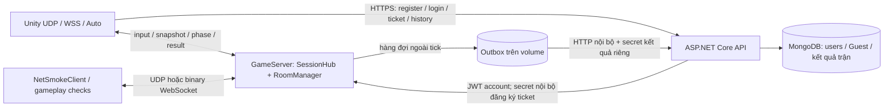

# Kiến trúc mạng Jungle Maze / Lastaway

## Chọn map theo phòng

Nguồn map phát hành là catalog `Backend/Shared/GameData/Maps/`; production đọc bản ngoài image qua `MAP_DATA_PATH`. Local Compose bind `Backend/data/maps`, AWS chuẩn bị `/opt/junglemaze/data/maps`. `MapPublisher` validate cả gói, giữ payload ID/hash bất biến, lưu manifest cũ, đổi catalog nguyên tử; `/internal/maps/reload` có secret chỉ ở control API private đưa snapshot catalog đã parse vào hàng đợi ứng dụng. Không upload/reload công khai, không I/O/parse trong tick.

Mỗi room giữ MapDefinition riêng. Bộ luật dùng RulesHash độc lập với MapHash. Trận được chốt bằng **MapId + MapHash + RulesHash** và ghi bộ khóa này vào kết quả/outbox/Mongo/lịch sử. Hai map khởi đầu cùng luật, khác bố cục: Di tích cổ và Bãi đá. World, movement/collision, spawn, loot/portal đều nhận map của room. Trận đang chạy không đổi dữ liệu khi reload; phòng chờ chuyển bản mới hoặc map mặc định còn được phát hành.

Gameplay protocol **2** bổ sung RoomMapState/SelectRoomMap/RoomMapReady/StartRoomMatch và metadata kết quả; client cũ nhận `GameplayVersionMismatch`. Handshake account-ticket vẫn **v4**, không gửi JWT qua UDP. Trưởng phòng phiên tách khỏi account owner quản lý/xóa room. Phòng tạo thêm chờ chủ account vào làm trưởng phòng đầu tiên; phòng mặc định lấy người vào đầu; khi trưởng phòng rời phòng chờ, quyền chuyển cho người còn kết nối sớm nhất.

Client lấy catalog, JSON và preview qua `/api/maps` yêu cầu JWT. JSON tối đa 2 MiB, PNG tối đa 512 KiB; remote HTTPS, HTTP chỉ loopback. Cache tách origin/hash, payload kiểm hash/schema trước khi nhận; tải bằng file tạm, lỗi không dùng map khác. Generation/revision và cancellation chặn callback cũ. Offline vẫn dùng bundle, không gọi API. Trưởng phòng chỉ Bắt đầu sau khi đủ người và mọi client đã xác minh; vào/rời countdown hủy lượt bắt đầu. Sau kết quả giữ kết nối về phòng chờ để chọn map/lượt mới.

Quy trình dev xuất/publish/rollback và kiểm hai máy nằm ở [Level Editor](hvu/06_Level_Editor.vi.md). NetSmokeClient có `--gameplay` để tải/ack map, trưởng phòng gửi Start và kiểm vòng trận; `NET_SMOKE_MAP_ID` chọn map cho lượt smoke. Đây là kiểm protocol/backend, không thay nghiệm thu gameplay Unity. Không chạy tải hoặc deploy AWS tự động.

Cập nhật Phase 2 ngày **03/11/2026**. Tài liệu mô tả kiến trúc dùng để triển khai game và ranh giới giữa các module. Setup nền nằm trong [hướng dẫn Phase 1](Phase1_First4Tasks.vi.md); chạy trận/account/bo theo [hướng dẫn Phase 2](Phase2_Match_Guest_Zone.vi.md). Bằng chứng nghiệm thu nằm trong [báo cáo Phase 2](Reports/Phase2_Local/report.vi.md); số liệu mạng các lượt trước ở [báo cáo Phase 1](Reports/Local_Capacity_Retest_2026-10-14/report.vi.md).

## 0. Đường chơi và phạm vi thẩm quyền

Local offline dùng OfflineMatchSession trong Unity, dữ liệu runtime có kiểm manifest và scene Game; không mở socket hoặc HTTP, không Docker, không gửi kết quả lên API/outbox. Luật solo bỏ chờ6 người và không trao LastAlive ngay; nhân vật sống tới khi bo loại rồi xem kết quả/chơi lại. Đây là chế độ luyện tập, không nguồn thành tích authoritative.

LAN dùng UDP tới IP LAN host; Online tự host dùng IP Radmin VPN với UDP, hoặc AWS Auto UDP/WSS443. Các mode này dùng cùng GameServer authoritative bên dưới; không đưa logic offline vào server online. UI chỉ hiện trường cần thiết, phần Nâng cao giữ backend loopback/CLI/profile cũ. Radmin phải được cài và cấu hình riêng; game không vượt mọi chính sách chặn mạng.

Replay có packet riêng version1, giữ nguyên layout packet cũ. SessionHub xác định người yêu cầu từ session trong room, chỉ cho nạn nhân đã bị loại lấy150frame kết thúc ở death tick server, chỉ nạn nhân+killer, tối đa3 request/người/trận. Mỗi chunk tối đa75frame (<4KiB); client kiểm shape, số frame, metadata và discard/cancel. API/DB không tham gia tick hay đọc replay. Zone/unknown killer dùng NoData, cửa sổ ngắn dùng TooShort. Tick/room/MatchId mới dọn buffer; Bootstrap nối NetworkKillcamReplaySource. Không dùng task ngoài phạm vi làm tiêu chí nghiệm thu.

## 1. Định hướng và trạng thái triển khai

Game dùng **server authoritative**: client gửi input; GameServer quyết định vị trí, va chạm, HP, bo, vòng đời và kết quả trận. Mỗi phòng có runtime riêng. Hạn mức cấu hình: **10 người/phòng, 5 phòng gồm mặc định, tổng 50 slot active/pending/grace**, mỗi account tạo tối đa 2 phòng bổ sung. Đây là hạn mức, không phải cam kết hiệu năng gameplay cho 50 người.

Phase 2 gồm SRV-03, NET-02, ZON-01 và demo Unity UDP/WebSocket/Auto. Prediction/reconciliation/interpolation đầy đủ thuộc MOV-02/03. Các module vũ khí, inventory, world và HUD được ghép qua các service đang có. Audio dùng MatchAudioEventSource nhận combat online/offline và pose/địa hình thật; không phát lặp shot dự đoán khi nhận confirmation. Bảng chẩn đoán chỉ bật bằng F3, tách khỏi Lobby/HUD/kết quả chính. UI-03 dùng replay server theo quyền phiên. DRG-01, ART-06, Game-10 tạm ngoài phạm vi; không dùng sự kiện rồng giả để nghiệm thu audio.

Bản Phase 2 Local và lần mở rộng online được ghi riêng trong báo cáo Phase 2. Chỉ deploy EC2 trong cửa sổ đã được chủ máy dành riêng. Lượt account-flow này dùng `-UseRunningInstance -KeepInstanceRunning`: không Stop/Start, không cài timer tắt máy; deadline chỉ đóng công cụ/client. EC2 tiếp tục tiêu credits sau test. Những lượt cũ dùng chính sách Stop phải được ghi riêng. Các kết quả AWS cũ chỉ chứng minh phiên bản ghi tại lượt đo đó. Hai PC vật lý phải được kiểm tra riêng.

Server đo thêm tick/loop tối đa, khoảng cách giữa vòng chạy, GC pause và thời gian xuất metrics trước đó để chẩn đoán stall hiếm. Vẫn báo dropped tick và giữ giới hạn catch-up; số đo này không tự sửa hoặc che lỗi hiệu năng.

## 2. Topology và đường đi dữ liệu

Local: Docker publish loopback mặc định. UDP host 7777, API 5000, Mongo Compass 27018; WebSocket Local `ws://127.0.0.1:7781/game`. Trong container GameServer bind `0.0.0.0`; `PUBLISH_HOST` chọn interface của máy host. LAN chọn IP host phù hợp và mở firewall đúng cổng. HTTP chỉ dùng cho API loopback; credential dài hạn từ xa phải đi HTTPS.

AWS: EC2 hiện có, Caddy public 80/443, UDP 7777. Caddy chuyển **đúng `/game`** tới `game-server:7781`; API tới `api:5000`. Basic auth chỉ bảo vệ Swagger. Mongo 27017, room-control 7780, listener 7781 và API 5000 không publish public. Caddy phải chặn `/internal` và `/internal/*` trước tuyến API.

UDP là đường chính, WSS443 là dự phòng của cả Unity Windows/Editor và NetSmokeClient. Auto thử UDP tối đa5s, rồi WebSocket tối đa10s mở kết nối và5s join. RoomFull/ServerFull/mã sai trả thẳng; không đổi đường để vượt kiểm tra. Sau join không tự đổi đường. Mỗi lượt kết nối có attempt riêng; chuyển trong lúc join/resume giữ một slot và proof resume chỉ xoay một lần. WSS vẫn cần DNS và HTTPS được mạng cho phép. SSM chỉ dùng quản trị.

Selfhost dùng `compose.host.yaml`, DB/volume/secret riêng. VPN: Tailscale Serve HTTPS tới Caddy loopback8080; UDP qua IP VPN. Public: hostname khác AWS, Caddy80/443 và UDP7777, cần IP public/router phù hợp. Không mở Mongo, API5000, control7780 hoặc listener7781 ra ngoài. Các profile `phase2-local/lan/vpn/selfhost/aws` dùng chung schema, không bỏ kiểm tra TLS.

## 3. Project, công nghệ và trách nhiệm

| Module | Trách nhiệm |
| --- | --- |
| `Backend/GameServer/Simulation` | C# thuần 30Hz; `IMatchRuntime`, `IEntityRegistry`, `IServerClock`, `IHealthService`; map, movement, bo, kết quả |
| `Backend/GameServer/Networking` | Adapter LiteNetLib / ASP.NET WebSocket; handshake, session, resume, packet; không tự tính luật trận |
| `Backend/GameServer/Rooms` | Nguồn dữ liệu phòng; lệnh HTTP nội bộ được xếp hàng để vòng ứng dụng xử lý |
| `Backend/Shared/Protocol` | Package Unity dùng chung; schema và serializer nhị phân, không sở hữu transport |
| `Backend/Shared/GameData` | Nguồn chuẩn có version của map, luật trận và lịch bo |
| `Backend/Api` | Account/JWT, quyền chủ phòng, Guest/ticket, lịch sử và lưu kết quả authoritative |
| `Assets/_JungleMaze` | Composition root + port/service; MatchSession nhận trạng thái; view vẽ và gửi input |
| `Assets/Imported/JSurviv` | Mã tham khảo; Socket.IO cũ, `AutoConnectLegacy=false`; không tự trở thành client của backend mới |

Luật dùng chung và map offline được đồng bộ sang `StreamingAssets/JungleMaze/runtime`; map online đọc từ catalog/API đã xác minh của từng phòng. Menu Unity **Jungle Maze → Phase 2 → Sync Runtime Data** tạo bản sao và manifest SHA256. Build từ chối dữ liệu cũ; client so version/hash với server trước LoadingAck. Không sửa bản sao để đổi luật server.

Di tích cổ 50×50 giữ 4 cover hình chữ nhật của map gốc; Bãi đá giữ cùng số loại vật thể nhưng có cover/đường đi/portal khác. Online dựng cover và world view từ map đã xác minh, không dùng collider cứng của scene Game; server mô phỏng nhân vật tròn, sweep/slide với cover và biên bằng C#; không chạy Unity Physics2D. 10 spawn trong bo đầu, tránh cover và cách nhau ít nhất 6 cell. Data version1.1.0 bổ sung cố định60 rương,90 chum,45 bụi,3 cặp portal,2 cửa,2 đầm lầy,2 lava,4 poison; giữ geometry/spawn gốc. Tổng215 object gồm4 cover. Manifest/hash phải khớp giữa server và Unity. Bo r25 tâm (25,25) làm các góc map nằm ngoài vùng an toàn.

## 4. Account bắt buộc và dữ liệu Guest cũ

| Việc | Bằng chứng quyền |
| --- | --- |
| Tạo/list/xóa phòng | JWT account hợp lệ; owner từ claim `sub`, không từ user ID client gửi |
| Join/chơi LAN/online | Account JWT → HTTPS `/api/game-tickets` → handshake v4 mang ticket + RoomCode; server cấp PlayerSessionId và gắn account đã xác minh trước roster |
| Hồ sơ Guest lâu dài | Credential ngẫu nhiên; Mongo chỉ giữ hash, Windows dùng DPAPI current-user theo origin API |
| Account của phiên | Ticket ngẫu nhiên 256 bit/64 hex, dùng một lần, TTL 30s, ràng buộc account + attempt + phòng; JWT chỉ qua API HTTPS, game transport không mang JWT |
| Xem lịch sử cá nhân | JWT hoặc Guest credential đã xác minh, không truy vấn theo nickname |
| Ghi kết quả | GameServer qua tuyến nội bộ, secret kết quả riêng; client không được tự nộp rank/điểm |

Guest cũ chỉ giữ dữ liệu/lịch sử, **không được cấp vé chơi mới hoặc quản lý phòng**. Không tự gộp/xóa Guest/account theo tên. LAN/online mất API thì không nhận lượt join mới; trận đang chạy tiếp tục không chờ API/DB. Local luyện tập vẫn dùng được khi không có API. JWT hết hạn không đá người đang chơi; lượt kết nối mới phải xác thực lại.

API: `POST /api/guests`, `POST /api/game-tickets`, `GET /api/me/matches`, `GET /api/matches/{matchId}/leaderboard`; `POST /internal/match-results` chỉ dành cho GameServer. Lịch sử phân trang, leaderboard công khai đã loại ProfileKey/credential. Các endpoint account và room cũ giữ nguyên.

## 5. Session, slot và vòng đời trận

`Waiting → Lobby → Loading → InGame → Ending → Cleanup → Waiting`.

Main: min6/max10. Trưởng phòng chọn map, tất cả client xác minh đúng MapId/MapHash/RulesHash, rồi trưởng phòng bấm Bắt đầu; countdown 15s không có nút Ready. Vào/rời trong countdown hủy về Waiting và cần Bắt đầu lại. Hello là xác nhận khả năng gameplay; client chỉ ping không được tính vào người đủ điều kiện bắt đầu. Thiếu người hủy countdown. Loading chốt roster, tối đa30s, loại người không xác nhận; dưới min quay về Waiting. Profile `test` dùng min2 và tăng tốc bo/timer, chỉ cho nghiệm thu Local, không dùng public hosting.

Loading/InGame/Ending từ chối người mới `MatchInProgress`. Mất mạng trong trận giữ avatar/slot15s từ lúc server phát hiện; avatar đứng yên, vẫn bị damage. Resume dùng proof ngẫu nhiên riêng, luân chuyển sau mỗi lần dùng, giữ PlayerId/slot và chỉ một kết nối điều khiển. Hết grace hoặc chủ động thoát bị loại; callback cũ không giải phóng slot mới.

Server xử lý toàn bộ damage của tick rồi xét thắng. Còn một người: thắng; không ai: hòa, không trao win. Cùng tick bị loại đồng hạng. Không có công thức điểm tổng. Mục tiêu420s không cưỡng bức kết thúc. Ending10s hoặc mọi người còn kết nối xác nhận chơi lại; dọn entity/input/bo cũ, giữ phòng và kết nối hợp lệ, tạo MatchId mới.

Runtime tạo từ biến môi trường luôn yêu cầu account-ticket v4; không có env tắt guard. v1/v2/v3 chỉ còn fixture riêng tạo trực tiếp trong test, không bypass LAN/AWS. v4 thêm ticket vào v3, payload connect tối đa512 byte. Auto giữ cùng attempt/ticket, chỉ chuyển UDP→WSS một lần trước thông điệp ứng dụng đầu tiên; callback UDP muộn không tạo lại slot. Resume cần proof còn hạn và ticket mới của cùng account, proof xoay sau khi xác minh. Gameplay có version riêng, MatchId, input sequence/tick và snapshot ack. Phase/roster/spawn/despawn/elimination/result gửi reliable; snapshot+zone30Hz có thể bỏ gói cũ. Client bỏ dữ liệu thuộc trận cũ. Binary WebSocket tối đa4KiB sau ghép fragment, hàng gửi có giới hạn; client chậm bị ngắt. Không gửi JWT hoặc credential Guest dài hạn qua UDP public.

## 6. Tick, Safe Zone và kết quả

Chỉ vòng ứng dụng thay đổi room/session/world. Input chuẩn hóa đường chéo, speed4 cell/s, ngừng khi thiếu input250ms; từ chối input trùng/cũ/sai trận và giới hạn tốc độ. Snapshot/ack30Hz chứa vị trí, aim, HP và sequence đã xử lý. Replay buffer riêng ít nhất5s; UI-03 chỉ đọc theo quyền phiên như mục0, không công khai toàn bộ buffer.

| Co bo từ lúc InGame | Bán kính |
| --- | --- |
| 90–97s | 25 → 18 |
| 182–188s | 18 → 12 |
| 268–273s | 12 → 7 |
| 343–347s | 7 → 3 |
| 387–390s | 3 → 0 |

Cảnh báo trước10s. Seed trận quyết định tâm; bo sau nằm trong bo trước và có vùng đi được/đường tiếp cận. Server phát tâm hiện tại/kế tiếp và tick co; client không tự random. Ngoài bo:5HP/s qua HealthService dùng chung, không tính giáp; cùng tick không trừ hai lần. R0 gây damage ở mọi vị trí tới khi còn tối đa một người.

Kết quả bất biến chứa MatchId, RoomId/config version, UTC, lý do, phiên/tên/hạng/kills/thời gian sống. Hàng đợi ngoài tick ghi outbox trên volume rồi gửi API nền, retry có backoff. Mongo insert nguyên tử theo MatchId: bản gửi lại giống nhau không cộng thêm; cùng khóa khác nội dung bị từ chối. API/DB lỗi không chặn mô phỏng hay màn hình kết quả; outbox đầy/lỗi phải được báo, không coi là đã lưu.

## 7. Release, dữ liệu và vận hành

Local/AWS có DB, secret, endpoint và volume riêng. `ROOM_CONTROL_TOKEN` bảo vệ room/ticket nội bộ; `MATCH_RESULT_TOKEN` bảo vệ ghi kết quả, không dùng lại JWT key. `MATCH_OUTBOX_PATH` phải nằm trên volume để retry qua restart. Lịch sử lỗi không dừng trận đã xác thực; lượt join mới vẫn cần API cấp account-ticket. Offline không phụ thuộc API.

Restart giữ users/Guest/kết quả và outbox trên volume; session, trận đang chạy và phòng bổ sung trong RAM mất, phòng mặc định tạo lại. Không tự tạo kết quả cho trận bị ngắt. Update release có checksum, giữ bản trước để rollback và không ghi đè cấu hình bí mật. Triển khai AWS Phase 2 cần một cửa sổ riêng sau nghiệm thu Local.

Windows giữ Unity6000.3.15f1. Lượt map ngày03/11 có hai client UDP và hai client WebSocket Local hoàn tất kịch bản và process exit0. Trước đó lượt account-flow từng có crash native lúc thoát trong cleanup Accessibility; dù scenario đã ghi nhận kết quả, process exit lỗi vẫn làm cổng Local thất bại. Không deploy AWS khi cổng này chưa đạt. Bản sửa engine được Unity ghi tại [6000.3.21f1, UUM-146676](https://unity.com/releases/editor/whats-new/6000.3.21f1); chưa thay Editor hoặc tắt accessibility để né lỗi.

## 8. Credits và nguyên tắc test lớp học

Dev dùng Local trước; không bật EC2 chỉ để compile/unit test. Khi cần online, đặt thời lượng trước khi chạy. Mặc định các buổi test tự quản dùng watchdog và Stop sau buổi; riêng lượt được chủ máy yêu cầu giữ Running dùng `-UseRunningInstance -KeepInstanceRunning`, không cài timer Stop và không kiểm Stop–Start. Deadline chỉ đóng client/công cụ. Không nâng instance/Unlimited hoặc mở port DB/control. Đóng client/SSH hoặc `docker stop` không dừng chi phí EC2. EBS vẫn có thể tính credits khi instance đã Stop.

Không suy diễn bài ping/pong cũ thành sức chứa gameplay. Khi bổ sung movement/combat/snapshot phải đo lại CPU, RAM, tick/dropped ticks, RTT, loss và tốc độ phát thực; lượt PC Sleep/biên dịch nặng hoặc generator thiếu tốc độ cần đánh INVALID.

## 9. Bằng chứng và phát triển tiếp

[Báo cáo chọn map mới](Reports/Map_Selection_Local/report.vi.md) ghi bản build và kiểm Local của tính năng map. [Báo cáo chung Phase2 trước đó](Reports/Phase2_Local/report.vi.md) phân biệt kết quả backend Local, Unity thực, AWS UDP/WSS và lượt co-located cũ. Kiểm thử hai process Unity trên cùng PC không thay nghiệm thu hai máy vật lý.

Các dev tích hợp gameplay qua contract runtime/health/registry; combat phát damage, không tự ghi HP từ client. MOV-02/03, combat/world và UI được ghép qua các service hiện có. Trạng thái nghiệm thu từng module và toàn flow phải theo bằng chứng bản mới trong báo cáo, không suy từ demo Phase2 cũ. Khung `Application/Testing`, `OnlineScenarioRunner` và launcher `test-unity-online.ps1` nhận scenario JSON và check/driver đăng ký qua Bootstrap, dùng lại cho feature mới. Test không đủ tốc độ phát phải ghi INVALID; [checklist hai PC](../Backend/Tests/OnlineReadiness/PHYSICAL_TWO_PC_CHECKLIST.md) ghi rõ LAN/VPN/public/AWS và phần cần nghiệm thu bằng thiết bị thật.
