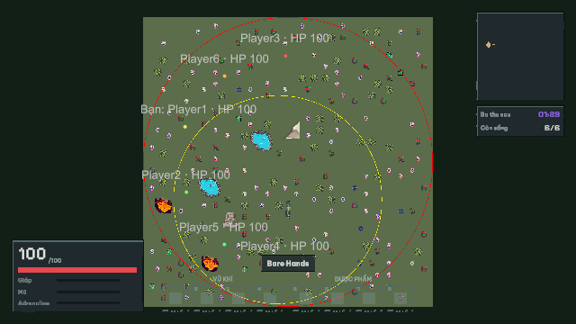
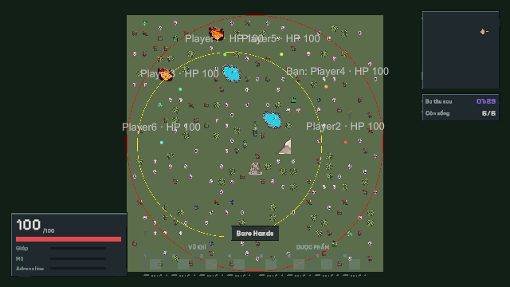
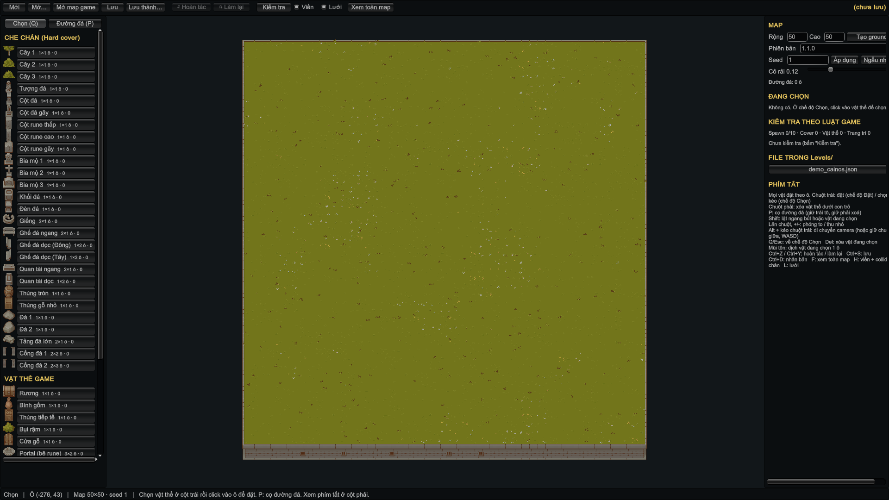

# Merge hvu và cập nhật AWS — 03/11/2026

## 1. Kết quả và phiên bản

Đã merge `origin/hvu` (**4227e5b0**) vào `codex/room-map-catalog-20261103`; merge commit **fedde93880595df8968c8c867389ce60ac1587fd**. Không merge main hoặc push. Đã lưu phần map catalog trước đó bằng commit `6bbf8ffa` và chỉnh scene cục bộ bằng `b660f2c2` trước khi merge; không auto-stash.

AWS hiện chạy **maps-hvu-20261103**, API/GameServer healthy; EC2 **Running** để chơi tiếp. Release cũ `/opt/junglemaze/releases/aws-account-20261102` và image cũ được giữ để rollback. Account, dữ liệu Mongo, default RoomCode, JWT/room-control/result/DuckDNS secret không đổi; kiểm diff cấu hình cũ/mới không có key nào đổi. Các phòng bổ sung/session nằm trong RAM cần tạo lại sau restart.

## 2. Đã tích hợp

- Level Editor theo ô, footprint/collider chân, ground/path theo seed, bộ vật thể Cainos, grid/flip, undo/redo và map mẫu của hvu.
- Xung đột scene: giữ nguyên nội dung scene local đã commit (ID/background/reference). Catalog/source mới của hvu được nhập; không ghi đè scene của người dùng bằng scene sinh lại. Tài liệu giữ cả hướng dẫn Editor mới lẫn publish/chọn map.
- Sửa đường export để truyền `LevelCatalog.BaseSizeOf/ShapeOf`. Nếu parse grid placement không có catalog, nó có thể thành 1×1 và mất collider chân. Fixture 50×50 với Tree01 đã roundtrip đúng obstacle geometry, không đổi bản nguồn, xuất thành công và qua validator backend.
- `demo_cainos.json` là mẫu nhỏ cho Editor; validator chủ động từ chối publish vì chưa phải 50×50. Không đổi giới hạn để né validation. Cainos/đường đá là art Editor; chưa tự ghép art đó vào renderer của trận.
- AWS có hai map phát hành: **Di tích cổ** và **Bãi đá**, chọn trong phòng; gameplay protocol **2**, account-ticket **v4**. Trưởng phòng Start sau khi đủ người/map ready; main vẫn **min6/max10**, 5 phòng/50 phiên. Không đổi luật trận hoặc kích thước máy.

## 3. Kiểm tra trước deploy và cách deploy

**906/906 EditMode, 133/133 PlayMode, 80 MapCatalogChecks PASS**. Unity MCP mở/Play Level Editor thật, ground/catalog hiển thị, Console không có error. Windows **6000.3.15f1** build thành công (report: 0 error, 0 warning); không nâng Editor. Kiểm export bằng Editor rồi CLI backend validate: PASS.

Trước deploy xác nhận HTTPS/TLS `/health`, SSM Online, server không có người chơi và đủ ổ đĩa. Chỉ cập nhật API/GameServer và Caddy routing hiện có; Mongo container/volume giữ nguyên. Không Stop/Start EC2, không cài watchdog tắt máy.

Full release khoảng 91,5 MiB được giữ Local. Do SFTP qua SSM chậm, hủy đúng tiến trình upload đã xác minh command line và dùng công cụ delta hiện có: **4.347.365 byte**, tái dùng 6 runtime layer. Kiểm checksum/provenance, root filesystem và runtime config trước deploy; image ID có thể đổi do repackaging nhưng đã đối chiếu layer/config. Deploy thành công, chưa cần rollback. Các archive truyền tạm và images.tar.gz ở staging AWS đã xóa; release/image cũ vẫn giữ.

## 4. Kiểm thử online từ PC

| Hạng mục | Kết quả |
|---|---|
| Đăng ký/login, JWT tạo phòng | PASS; thiếu/sai JWT và Guest không tạo được phòng/không lấy vé chơi mới |
| Catalog/map/PNG qua HTTPS | PASS; JWT bắt buộc; 2 JSON và 2 preview đúng hash; hash sai 404 |
| Bãi đá: 6 Windows client / 300s kết nối mỗi client | PASS 6/6, exit0; cố ý dùng UDP7779 không có listener, cả 6 Auto fallback WSS |
| Flow Bãi đá | PASS: join, thấy người khác, movement, bo, HP damage, result, history, replay; mỗi client ghi 2 trận hoàn tất |
| Di tích cổ: 6 client / preflight | PASS 6/6, exit0; 3 ép WSS và 3 Auto thực tế chọn UDP7777; có movement/zone, khoảng 30s mỗi client |
| Hai PC vật lý / nhóm người thật | NOT_TESTED; 6 process trên một PC, không thay bằng chứng 6 người hoặc hai thiết bị |

Mỗi lượt dùng fixture QA tự tạo; các client trong cùng lượt dùng cùng account QA. Đây không phải bài kiểm 6 danh tính độc lập. Hai lượt dùng room riêng và được xóa sau khi đóng client. Di tích cổ chỉ là lượt preflight, không có tiêu chí result/history cho lượt ngắn đó.

## 5. Số đo và giới hạn độ trễ

| Map / client | Transport | Input Hz | RTT p50 / p95 / p99 ms | Pong timeout | Trận hoàn tất |
|---|---|---:|---|---:|---:|
| bai-da / Player1 | Wss | 29.97 | 300.0 / 334.0 / 935.5 | 0 | 2 |
| bai-da / Player2 | Wss | 29.97 | 300.0 / 333.4 / 800.1 | 0 | 2 |
| bai-da / Player3 | Wss | 29.96 | 300.1 / 533.6 / 666.7 | 0 | 2 |
| bai-da / Player4 | Wss | 29.97 | 300.0 / 333.4 / 666.8 | 0 | 2 |
| bai-da / Player5 | Wss | 29.97 | 300.1 / 367.2 / 733.7 | 0 | 2 |
| bai-da / Player6 | Wss | 29.97 | 300.0 / 466.7 / 666.8 | 0 | 2 |
| di-tich-co / Player1 | Wss | 30.00 | 276.1 / 320.8 / 329.9 | 0 | 0 |
| di-tich-co / Player2 | Wss | 30.00 | 300.0 / 300.5 / 528.6 | 0 | 0 |
| di-tich-co / Player3 | Wss | 30.00 | 300.0 / 467.8 / 486.6 | 0 | 0 |
| di-tich-co / Player4 | Udp | 29.99 | 300.0 / 301.4 / 301.7 | 0 | 0 |
| di-tich-co / Player5 | Udp | 29.99 | 300.0 / 300.5 / 470.5 | 0 | 0 |
| di-tich-co / Player6 | Udp | 29.99 | 366.7 / 400.0 / 433.3 | 0 | 0 |

66 mẫu server có 6 peer: tick **29.97–30.20 Hz**, dropped tick **0**, tick overrun **0**, CPU tối đa **20.18% một core**, process working set tối đa **123.93 MiB**. Container giới hạn 256 MiB, không OOM/restart. Collector Docker stats có memory% tối đa 29.64% theo cách hạch toán Docker (khác process RSS).

Kết nối đã hoạt động nhưng RTT khoảng **300 ms**, p99 của lượt dài có lúc tới **935,5 ms**. Server tick ổn định không đồng nghĩa WAN luôn mượt; chưa cam kết cảm giác combat real-time ở mạng/Sydney hiện tại. Client có catchupDrop được giữ nguyên trong JSON, không che bằng số server dropped tick=0. Không áp ngưỡng RTT Local cho WAN; không đo 50 người hoặc suy ra sức chứa gameplay tối đa.

## 6. Cách bạn chơi và tạo map

1. Mở **Builds/Windows-6000.3.15f1/Lastaway.exe** bản mới. Mặc định vẫn **Online AWS** (`junglemaze.duckdns.org`). Client cũ trước gameplay protocol2 cần thay bản mới.
2. Đăng ký/đăng nhập → tạo hoặc vào phòng → trưởng phòng chọn Di tích cổ/Bãi đá → đợi tải đủ map và **ít nhất 6 người** → Bắt đầu. Kết quả → chơi lại trở về phòng chờ; không tự bắt đầu trận kế tiếp.
3. Tạo/sửa map theo [hướng dẫn Level Editor](../../hvu/06_Level_Editor.vi.md): xuất → validate → publish → reload nội bộ; không sửa file đã đặt theo hash. Cần 50×50, 10 spawn an toàn và các kiểu vật thể client đã hỗ trợ. Sửa dữ liệu được hỗ trợ không cần rebuild client/server; thêm type/art runtime mới vẫn cần client mới.
4. Swagger: [API AWS](https://junglemaze.duckdns.org/swagger). Basic auth Swagger và account player là hai lớp hiện có; không đưa key/mật khẩu vào report.

## 7. Bàn giao và trạng thái cuối

[report.json](report.json), [metrics.csv](metrics.csv), [evidence.zip](evidence.zip) + checksum chứa test job/build/export, log, ảnh và JSON của cả 12 lượt client. Ảnh Editor:

Đã đóng client, xóa room QA, dừng collector thuộc lượt test, trả Unity về Boot và giữ EC2 **Running** theo yêu cầu dùng online. Dọn file tạm của tác vụ sau khi kiểm ZIP/checksum; giữ full/delta release Local để đối chiếu và rollback. Không prune volume Mongo, image rollback hoặc sửa credentials. Graphify cập nhật sau code/config; graph là công cụ điều hướng, không thay bằng chứng runtime và còn cảnh báo parser/reference từ thư viện.

**EC2 tiếp tục tiêu credits khi Running.** Khi hết buổi chơi, tự Stop trong AWS Console; đóng game/SSH không Stop instance. Chưa kiểm hai PC vật lý hoặc mạng khác. Không nâng instance, không bật Unlimited, không tạo tài nguyên AWS mới.
