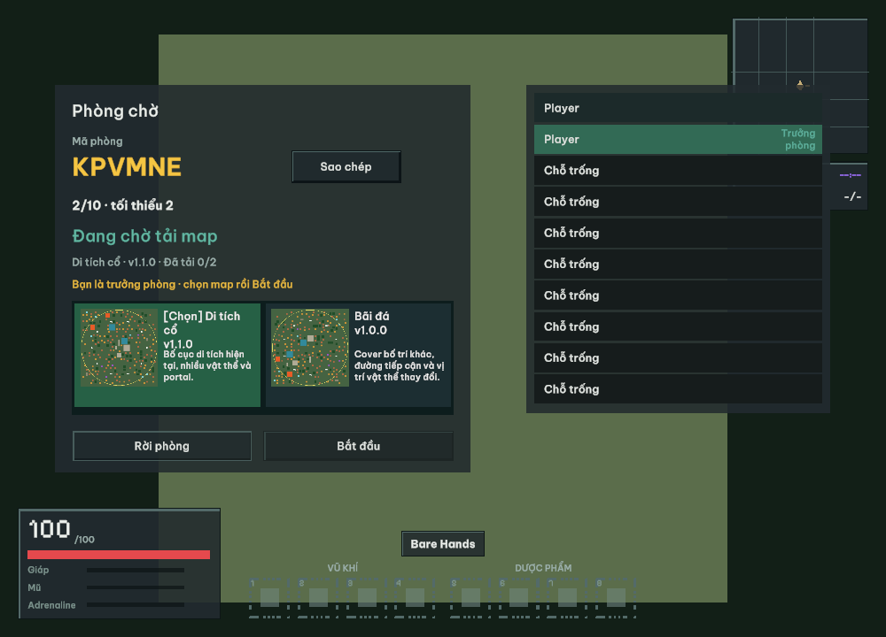
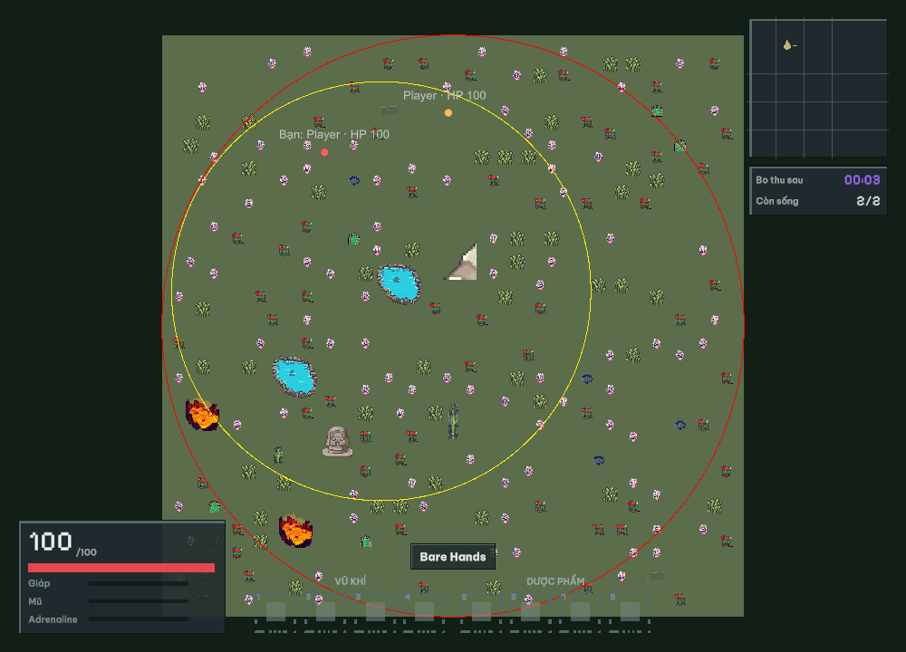
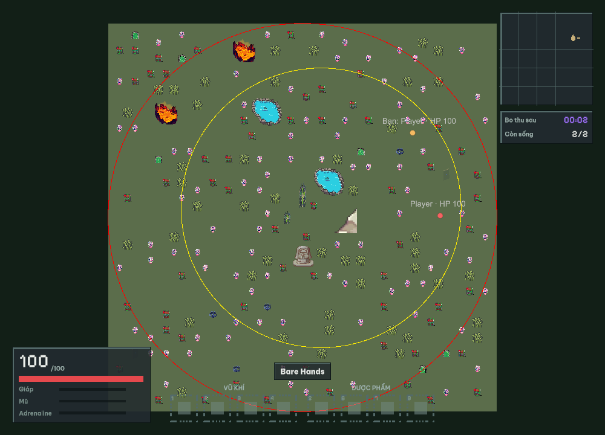

# Báo cáo chọn map trong phòng — Local, 03/11/2026

## 1. Phạm vi và bản kiểm thử

Đã ghép chọn map vào flow tài khoản/phòng hiện có và kiểm chứng hai Windows client qua UDP và WebSocket Local. Không triển khai AWS trong đợt này. Branch `codex/room-map-catalog-20261103`, base `fe8226766f982e26bbc609ba7c6545ab68210ea7`; code chưa commit. Giữ Unity **6000.3.15f1**, account-ticket **v4**, gameplay protocol **2**, giới hạn **10/5/50**. Main vẫn tối thiểu 6 người; các flow bản mới dùng test profile 2 người tăng tốc. Đây không phải báo cáo đo tải hoặc nghiệm thu hai PC.

Giữ các sửa có sẵn của `LevelEditor.unity`, `LevelEditorCatalog.asset` và cấu hình ProBuilder; không sinh lại scene/catalog của người dùng.

## 2. Đã triển khai những gì

- Catalog `Backend/Shared/GameData/Maps/catalog.json`: **Di tích cổ** 1.1.0 (mặc định) và **Bãi đá** 1.0.0. Bãi đá có cover và placements/spawn/portal khác, được lưu cố định. Hai map cùng 10 spawn hợp lệ. Preview 512×512 sinh từ dữ liệu, là sơ đồ chứ không phải ảnh mỹ thuật.
- Mỗi phòng có map/version/hash và trưởng phòng riêng. Trưởng phòng chọn/start; tất cả xác minh map mới được countdown. Join/rời/disconnect trong countdown hủy start; sau kết quả trở lại phòng chờ, trưởng phòng bắt đầu lại.
- Client lấy catalog/JSON/PNG bằng API có JWT; không truyền JWT qua UDP. Cache tách backend/hash, tải có giới hạn/timeout/file tạm, kiểm hash/schema/rules, hủy callback cũ và có nút retry. Cả prediction/collision/world/spawn dùng map đã xác minh. Offline vẫn dùng map đóng gói, không cần API.
- `MapHash` độc lập `RulesHash`; result/outbox/history/leaderboard giữ map identity. UDP và WS dùng cùng authoritative room/runtime. Client gameplay cũ bị từ chối rõ ràng; handshake account v4 được giữ.
- Export trong Level Editor, validator/publisher CLI, external maps mount, private-secret reload và lưu manifest lịch sử. Trận đang chạy giữ snapshot cũ; publish chỉ thay lượt sau. Không thêm endpoint upload công khai hoặc cơ chế tự xóa version cũ.
- DeepSeek thực hiện các gói text giới hạn; Codex review/apply, tích hợp và kiểm thử. Usage/requested/reported model và các job hủy được giữ trong ZIP; không tuyên bố số token/chi phí tiết kiệm.

## 3. Cách đã kiểm tra

1. Validate hai map, chạy kiểm thử catalog/host/runtime/protocol và hồi quy backend; build Docker Local với account API/Mongo thật.
2. Unity Editor thực chạy 886 EditMode, 133 PlayMode; xuất fixture bằng công cụ Editor rồi CLI validate; build Windows tại 6000.3.15f1.
3. Hai account riêng, hai Windows process: UDP chọn Bãi đá, WS chọn Di tích cổ; kiểm roster, chuyển động, bo/HP, kết quả, history và replay. Ảnh lobby/game/result, JSON, log và exit code nằm trong ZIP.
4. Hot publish Bãi đá 1.0.0→1.0.1 khi hai Unity player đang chơi; đối chiếu API phòng trước/trong/sau. Fixture này đổi version JSON/hash, không đổi geometry. Live catalog 2→1→2 kiểm fallback và hash cũ còn tải được; đã trả về hai map gốc.
5. 11 phiên hỗn hợp kiểm đúng 10 join, một RoomFull; từng phiên join phải xác minh map và có snapshot. Các bài quyền host/hai phòng khác map/cache hỏng chủ yếu là module test, được phân biệt ở bảng dưới.

## 4. Kết quả và số đo

| Hạng mục | Trạng thái | Bằng chứng / giới hạn |
|---|---|---|
| Catalog / hai map | PASS | 80 MapCatalogChecks; hai map/spawn/geometry/placements hợp lệ; ID/hash/path/bounds/schema được kiểm. |
| Host / Start / countdown | PASS | Creator/default host, chuyển quyền, cấm người khác, map-ready, join/leave/disconnect hủy countdown; không tự chạy lượt sau. |
| Hai phòng độc lập | PASS_MODULE | Hai runtime đồng thời nhận map/layout/world/hash khác nhau trong MapCatalogChecks; không phải bốn Unity client. |
| API catalog và payload | PASS | API Docker thật: JWT bắt buộc, JWT sai 401, hash không tồn tại 404; tải/xác minh hai JSON và hai PNG. |
| Cache / hủy / lỗi / retry | PASS_MODULE | 8 EditMode test mới: origin/hash, file lỗi/quá cỡ, HTTPS, callback cũ, retry; Unity thật tải và dùng dữ liệu đã xác minh. |
| Publish / reload / rollback | PASS | Validate/export fixture; publish nguyên tử và gói lỗi giữ catalog; live 2→1→2, fallback và lấy hash cũ; khôi phục catalog hai map. |
| Hot publish trong trận | PASS_FLOW | Hai Unity player giữ Bãi đá 1.0.0 trong trận; phòng/lượt sau nhận 1.0.1/hash mới. Fixture đổi version JSON, không thử layout thứ ba. |
| UDP hai Windows player | PASS_FLOW | Cả hai account join, thấy người khác/di chuyển/bo/HP, kết quả, history, replay; exit 0. |
| WS hai Windows player | PASS_FLOW | Cùng flow qua ws://127.0.0.1:7781/game; exit 0. Chưa phải WSS Internet. |
| 10 phiên hỗn hợp / phiên 11 | PASS | 6 UDP + 4 WS có mapVerified/snapshot; phiên 11 RoomFull. Đây là smoke ngắn, không phải benchmark. |
| Kết quả có map identity | PASS | 77 MatchResultChecks và API/Mongo thật: history/leaderboard giữ MapId/Version/Hash/RulesHash cho hai version Bãi đá. |
| Hồi quy backend | PASS | Network 144 (rerun), Match 133, MatchResult 77; DualTransport, GameplayNetwork, World, WorldNetwork, Combat, Inventory, Telemetry exit 0. |
| Unity regression / Windows | PASS | EditMode 886/886; PlayMode 133/133; build 6000.3.15f1 thành công, 0 error/3 warning; bản bàn giao đối chiếu SHA256 từng file. |
| Hai PC vật lý / LAN | NOT_TESTED | Chỉ một PC; hai process không thay bằng chứng hai thiết bị. Có checklist riêng. |
| AWS / WSS public | NOT_TESTED | Không bật, deploy, test hoặc đổi trạng thái EC2 trong đợt này; compose AWS chỉ chuẩn bị mount maps. |
| 6 người main / tải dài | NOT_TESTED | Giữ cấu hình main min6, lobby15s; flow mới chạy profile test min2 tăng tốc. Không suy ra sức chứa gameplay từ smoke. |

| Client bản cuối | Input Hz | Snapshot Hz | RTT p50 / p95 / p99 (ms) | Pong timeout |
|---|---:|---:|---|---:|
| UDP 0 | 29.83 | 29.98 | 33.33 / 33.51 / 44.84 | 0 |
| UDP 1 | 29.83 | 29.94 | 33.33 / 33.73 / 39.36 | 0 |
| WS Local 0 | 29.73 | 29.92 | 33.33 / 39.15 / 72.14 | 0 |
| WS Local 1 | 29.72 | 29.91 | 33.36 / 43.03 / 69.86 | 0 |

Cả bốn process đều PASS, exit 0; mỗi process hoàn tất ít nhất một trận và thấy replay/history. Mỗi client ghi **1 catchupDrop**; không diễn giải thành server dropped tick hoặc tuyên bố zero-drop. Đây là lượt ngắn trên cùng PC, không có ngưỡng WAN và không thay benchmark dài 300 giây. Đo CPU/RAM/tick của lượt tải dài không nằm trong báo cáo này.

## 5. Lỗi tìm thấy, cách sửa và lượt không đạt

- Transport disconnect khi lobby còn trên min trước đây chỉ hủy countdown nếu thiếu người; đã đổi manual-room để mọi thay đổi thành viên hủy countdown, có red-before/green-after và test final tick. InGame grace không đổi.
- Cleanup xoay MatchId trước đây làm client mất OwnNetId và không nhận quyền host để start lượt sau; đã gửi lại welcome/proof sau Waiting/roster. Kiểm chơi lại thật trên cả hai transport.
- Probe history trước đây chỉ poll trong Ending ngắn; replay nhanh có thể đi qua trước khi outbox ghi xong. Một client WS đã FAIL history dù trận hoàn tất. Đã giữ poll cho MatchId kết quả sau replay; rebuild và hai client WS/UDP cuối đều PASS. Log FAIL trước sửa được giữ, không xóa khỏi bằng chứng.
- Lượt đầu có `WORLD_ENABLED=true` thay vì `1`, nên không đủ điều kiện world; đã sửa cấu hình test và chạy lại. NetworkChecks từng trượt timing khi build/pull Docker đồng thời; chạy riêng lúc máy rảnh đạt 144, không nới assertion.
- Graphify lần đầu gặp file PerformanceTestRunInfo tạm bị Unity xóa giữa lần đọc; đã chạy lại sau khi Unity hết test/build. Graph hiện 19.116 node/72.476 edge/470 community, HTML dạng community vì vượt 5.000 node. AST có cảnh báo parser UniTask và reference/generic trùng/dangling; không dùng graph làm bằng chứng compile. Semantic fragment khớp SHA tài liệu. Token 6.370/3.260 trong graph là số tự báo của lần extraction cũ; giám sát/cập nhật Codex không được đo tại đây.
- Build cuối 0 error, 3 warning: TMP wrapping obsolete ở panel mới và hai warning từ JSurviv (Start che member/field không dùng). Không coi warning là compile fail; chưa sửa code imported ngoài phạm vi.

## 6. Hướng dẫn thử lại và publish

Terminal tại `Backend`: `docker compose --profile account up -d --build`. `.env` cần secret điều khiển/kết quả hợp lệ, `WORLD_ENABLED=1`; dùng `MATCH_PROFILE=test` để test hai người, `main` cho min6/lobby15s. Không đổi secret hiện có chỉ để chạy lại.

Mở `Builds/Windows-6000.3.15f1/Lastaway.exe` hai lần. Mặc định vẫn là online AWS như cấu hình dự án; **chọn profile Local network / phase2-local** để test đợt này. Đăng nhập hai account → tạo/vào cùng phòng → trưởng phòng chọn thẻ map → đợi tải đủ → Bắt đầu. Kết thúc nhấn chơi lại để về phòng; không tự start. Chế độ Luyện tập offline không kiểm flow mạng/chọn nhiều map.

UDP dùng 127.0.0.1:7777; WS loopback dùng ws://127.0.0.1:7781/game với API http://127.0.0.1:5000. Remote phải HTTPS/WSS hợp lệ; không dùng HTTP LAN hoặc bỏ xác minh TLS. NetSmoke thêm `--gameplay` để xác minh map/ack và host start; `NET_SMOKE_MAP_ID` chọn ID. Đây là công cụ acceptance, không thay thao tác người chơi.

Quy trình **tạo → xuất → publish → chọn → cập nhật → rollback** đầy đủ: [Level Editor](../../hvu/06_Level_Editor.vi.md). Xem [Network Architecture](../../Network_Architecture.vi.md) và [checklist hai PC](../../../Backend/Tests/OnlineReadiness/PHYSICAL_TWO_PC_CHECKLIST.md). Tăng/giảm map bằng catalog, không sửa code; giữ ít nhất một map/default hợp lệ. API map thấy trong Swagger sau khi rebuild API hiện tại.

## 7. Bàn giao, dọn dẹp và giới hạn

Bản Windows ở `Builds/Windows-6000.3.15f1/Lastaway.exe`; manifest SHA256 mọi file trong `evidence.zip`. Dữ liệu chi tiết: [report.json](report.json), [metrics.csv](metrics.csv), [evidence.zip](evidence.zip) và checksum cạnh ZIP. Không đưa tài khoản QA, JWT, `.env` hoặc credentials vào báo cáo/worker.

Đã đóng client, xóa 1 phòng QA trống và Stop ba container Local sử dụng trong lượt này; giữ volume/account/map versions. Sau kiểm ZIP/CRC và SHA256 bản build bàn giao, đã xóa 164,118,030 byte file tạm (~156.5 MiB), chỉ giữ checkpoint nhỏ. Đã bỏ scene test sinh tự động đã xác nhận sạch và trả Editor về Boot; giữ scene/catalog Level Editor của người dùng. Không prune Docker/volume hoặc đụng AWS.

Không nghiệm thu AWS/WSS Internet, hai PC vật lý, tải dài hoặc sức chứa gameplay. Publish mới chỉ truyền JSON/PNG của vật thể client đã hỗ trợ; thêm script/prefab/type mới vẫn cần bản client mới. Chưa tự xóa version map cũ. Không sửa status Google Sheets, không commit/push/deploy.
